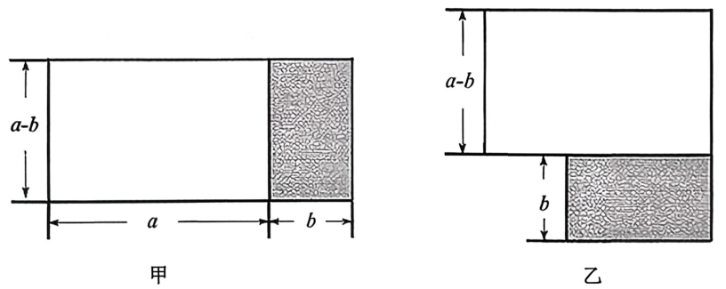

7. （2025八上·北京期中）将图甲中阴影部分的小长方形变换到图乙位置，你能根据两个图形的面积关系得到的数学公式是（ ）

A. $(a-b)(a+b)=a^{2}-b^{2}$

B. $(a+b)^{2}=a^{2}+2ab+b^{2}$

C. $(a-b)^{2}=a^{2}-2ab+b^{2}$

D. $(2a-b)^{2}=4a^{2}-4ab+b^{2}$

> [!question]- 点击查看答案与解析
> 【答案】A
> 
> 【考点】平方差公式的几何意义 → [[【初中数学知识点体系-人教版】#16-3 乘法公式]]
> 
> 【解析】
> 图甲中阴影部分的面积等于“边长为 $a$ 的正方形去掉边长为 $b$ 的小正方形”，即 $a^{2}-b^{2}$；
> 把这块阴影平移到图乙后，它拼成一个长为 $a+b$、宽为 $a-b$ 的长方形，面积为 $(a+b)(a-b)$。
> 两图中阴影部分的面积相等，所以 $(a+b)(a-b)=a^{2}-b^{2}$。选 A。
> 
> 【易错点】读图时把图乙的边长看成 $a$ 与 $b$（实际是 $a+b$ 与 $a-b$）；与完全平方公式 $(a\pm b)^{2}=a^{2}\pm 2ab+b^{2}$ 混淆。
