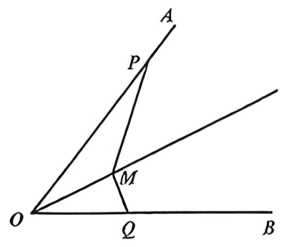

8. （2025八上·北京期中）如图，点 $M$ 是 $\angle AOB$ 平分线上的一点，点 $P$、点 $Q$ 分别在射线 $OA$、射线 $OB$ 上，满足 $OP=2OQ$，若 $\triangle OMP$ 的面积是 2，则 $\triangle OQM$ 的面积是（ ）

A. 4

B. 3

C. 2

D. 1

> [!question]- 点击查看答案与解析
> 【答案】D
> 
> 【考点】角平分线的性质（到角两边距离相等）→ [[【初中数学知识点体系-人教版】#14-3 角的平分线]]
> 
> 【解析】
> 点 $M$ 在 $\angle AOB$ 的平分线上，由角平分线的性质，$M$ 到 $OA$、$OB$ 的距离相等，记这个距离为 $h$。
> 以 $OP$ 为底时，$\triangle OMP$ 的高就是 $h$，所以 $S_{\triangle OMP}=\dfrac{1}{2}\cdot OP\cdot h=2$；
> 以 $OQ$ 为底时，$\triangle OQM$ 的高同样是 $h$，而 $OP=2OQ$，
> 所以 $S_{\triangle OQM}=\dfrac{1}{2}\cdot OQ\cdot h=\dfrac{1}{2}\times\dfrac{1}{2}OP\cdot h=\dfrac{1}{2}\times 2=1$。选 D。
> 
> 【易错点】面积比与底边比弄反（$S_{\triangle OMP}:S_{\triangle OQM}=OP:OQ=2:1$）；忘记“角平分线上的点到角两边距离相等”才使两个高相等。
