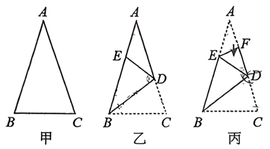

9. （2025八上·北京期中）已知一张三角形纸片 $ABC$（如图甲），其中 $AB=AC$，将纸片沿过点 $B$ 的直线折叠，使点 $C$ 落到 $AB$ 边上的 $E$ 点处，折痕为 $BD$（如图乙），再将纸片沿过点 $E$ 的直线折叠，点 $A$ 恰好与点 $D$ 重合，折痕为 $EF$（如图丙）。原三角形纸片 $ABC$ 中，$\angle ABC$ 的大小为（ ）

A. $30^{\circ}$

B. $36^{\circ}$

C. $45^{\circ}$

D. $72^{\circ}$

> [!question]- 点击查看答案与解析
> 【答案】D
> 
> 【考点】折叠（轴对称）的性质 → [[【初中数学知识点体系-人教版】#15-1 图形的轴对称]]、等腰三角形的性质与判定 → [[【初中数学知识点体系-人教版】#15-3 等腰三角形]]
> 
> 【解析】
> 设 $\angle C=x$，则 $\angle ABC=x$（$AB=AC$），$\angle BAC=180^{\circ}-2x$。
> 第一次沿 $BD$ 折叠：点 $C$ 落在 $AB$ 上的 $E$ 处，$D$ 在 $AC$ 上，所以 $DE=DC$，$\angle BED=\angle C=x$。
> 第二次沿 $EF$ 折叠：点 $A$ 与点 $D$ 重合，所以 $EA=ED$，$\triangle AED$ 是等腰三角形，$\angle EAD=\angle EDA$。
> 因为 $A$、$E$、$B$ 共线，$\angle AED=180^{\circ}-\angle BED=180^{\circ}-x$，
> 所以 $\angle EAD=\angle EDA=\dfrac{180^{\circ}-(180^{\circ}-x)}{2}=\dfrac{x}{2}$。
> 又 $E$ 在 $AB$ 上、$D$ 在 $AC$ 上，故 $\angle EAD=\angle BAC=180^{\circ}-2x$。
> 于是 $180^{\circ}-2x=\dfrac{x}{2}$，解得 $x=72^{\circ}$，即 $\angle ABC=72^{\circ}$。选 D。
> 
> 【易错点】不说明“$E$ 在 $AB$ 上、$D$ 在 $AC$ 上”就直接把 $\angle EAD$ 当成 $\angle BAC$；把 $\angle BED$ 与 $\angle AED$ 当成相等（二者互补）。
