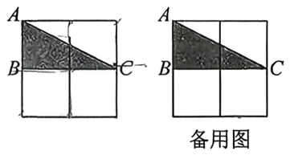

10. （2025八上·北京期中）如图是 $2\times 2$ 的正方形网格，格线的交点称为格点，以格点为顶点的三角形称为格点三角形，图中的 $\triangle ABC$ 为格点三角形，则正方形网格中与 $\triangle ABC$ 成轴对称的格点三角形的个数是（ ）

A. 6 个

B. 5 个

C. 4 个

D. 3 个

> [!question]- 点击查看答案与解析
> 【答案】D
> 
> 【考点】轴对称与格点三角形 → [[【初中数学知识点体系-人教版】#15-1 图形的轴对称]]、画轴对称的图形 → [[【初中数学知识点体系-人教版】#15-2 画轴对称的图形]]
> 
> 【解析】
> $2\times 2$ 网格有 9 个格点，与 $\triangle ABC$ 全等（三边长分别为 $1$、$2$、$\sqrt{5}$）的格点三角形共 16 个，其中有 15 个与 $\triangle ABC$ 不同。
> 逐一检验：与 $\triangle ABC$ 成轴对称，要求存在一条直线，使 $\triangle ABC$ 沿它翻折后恰好与那 15 个三角形之一重合，
> 即三组对应点的连线被同一条直线垂直平分。逐条试过网格的格线、网格的对角线及其垂直平分线，只有 3 个三角形满足（对称轴分别是过点 $B$、$C$ 的水平格线，网格的竖直中线，以及一条对角线的垂直平分线）。
> 所以与 $\triangle ABC$ 成轴对称的格点三角形有 3 个。选 D。
> 
> 【易错点】把“全等”当成“成轴对称”而错选 16 个方向的计数；漏掉“与自身重合”的那个不算。
