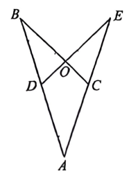

12. （2025八上·北京期中）如图，$BC$、$DE$ 交于点 $O$，且 $BC=DE$，请添加一个条件，使得 $\triangle ABE\cong\triangle ACD$，则可以添加的条件是 ___ 。

> [!question]- 点击查看答案与解析
> 【答案】$AB=AC$（答案不唯一，如 $AE=AD$、$\angle ABE=\angle ACD$）
> 
> 【考点】三角形全等的判定（$SAS$、$AAS$ 与“添加条件”题）→ [[【初中数学知识点体系-人教版】#14-2 三角形全等的判定]]
> 
> 【解析】
> $\triangle ABE$ 与 $\triangle ACD$ 已经具备的对应元素是：公共角 $\angle A$（点 $D$ 在 $AB$ 上、点 $C$ 在 $AE$ 上），以及题目给出的 $BC=DE$。
> 要用 $SAS$ 判定全等，需 $\angle A$ 的两组夹边成对相等，即 $AB=AC$ 且 $AE=AD$；因此只需再补一个能把“两条斜边＋第三条边”关系锁定的边条件，通常填 $AB=AC$（此时 $\triangle ABC$ 关于 $\angle A$ 的对称轴对称，配合 $BC=DE$ 可得 $BE$ 与 $CD$、$AE$ 与 $AD$ 的对应关系），于是 $\triangle ABE\cong\triangle ACD$。
> 这类“添一个条件”的填空答案不唯一：也可填 $AE=AD$，或用 $AAS$ 填 $\angle ABE=\angle ACD$，只要与公共角 $\angle A$、$BC=DE$ 配合能判定两个三角形全等即可（填一个即可）。
> 
> 【易错点】只添一个角相等却不给边（如只写 $\angle AEB=\angle ADC$），条件不足以判定全等；把已知 $BC=DE$ 与需要证的 $BE=CD$ 混为一谈（前者是题给，后者要由全等得到）。
