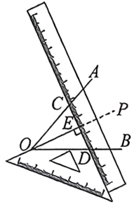

13. （2025八上·北京期中）如图，一个直角三角板的一条直角边经过 $\angle AOB$ 的顶点 $O$，一把直尺经过三角板的直角顶点 $E$ 并且与这条直角边垂直，直尺与 $\angle AOB$ 的两边分别交于 $C$、$D$ 两点，当 $CE=DE$ 时，$\angle AOE$ 与 $\angle AOB$ 的数量关系为： ___ ；

> [!question]- 点击查看答案与解析
> 【答案】$\angle AOB=2\angle AOE$
> 
> 【考点】线段垂直平分线的性质 → [[【初中数学知识点体系-人教版】#15-1 图形的轴对称]]、角平分线的判定 → [[【初中数学知识点体系-人教版】#14-3 角的平分线]]
> 
> 【解析】
> 三角板的一条直角边经过点 $O$，直尺经过直角顶点 $E$ 且与这条直角边垂直，所以 $CD\perp OE$，且 $E$ 在 $CD$ 上。
> 又 $CE=DE$，所以 $OE$ 是线段 $CD$ 的垂直平分线，于是 $OC=OD$。
> 在 $\triangle OCD$ 中，$OC=OD$ 且 $OE\perp CD$，由等腰三角形“三线合一”得 $OE$ 平分 $\angle COD$，
> 即 $\angle AOE=\angle EOB$，所以 $\angle AOB=\angle COD=2\angle AOE$。
> 
> 【易错点】只用 $CE=DE$ 就断定 $OE$ 平分 $\angle AOB$，漏掉“$OE\perp CD$”这个关键条件；把关系写成 $\angle AOB=\angle AOE$。
