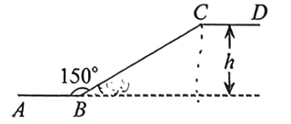
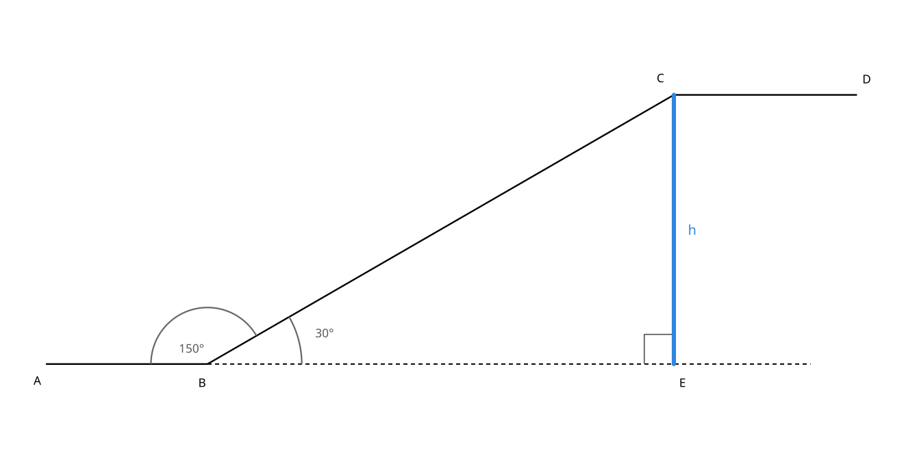

14. （2025八上·北京期中）如图，是某商场一楼与二楼之间的手扶电梯示意图。其中 $AB$、$CD$ 分别表示一楼、二楼地面的水平线，$\angle ABC=150^{\circ}$，$BC$ 的长是 10 m，则乘电梯从点 $B$ 到点 $C$ 上升的高度 $h$ 是 ___ m。

> [!question]- 点击查看答案与解析
> 【答案】5
> 
> 【考点】含 $30^{\circ}$ 角的直角三角形性质 → [[【初中数学知识点体系-人教版】#15-3 等腰三角形]]
> 
> 【解析】
> 如图，过点 $C$ 作 $CE\perp AB$ 于 $E$，则 $CE$ 就是电梯从点 $B$ 到点 $C$ 上升的高度 $h$。
> 因为 $\angle ABC=150^{\circ}$，所以 $BC$ 与水平线 $AB$ 的夹角为 $180^{\circ}-150^{\circ}=30^{\circ}$，即 $\angle CBE=30^{\circ}$。
> 在 $Rt\triangle BCE$ 中，$\angle BEC=90^{\circ}$，$\angle CBE=30^{\circ}$，$BC=10$ m，
> 由“直角三角形中 $30^{\circ}$ 角所对的直角边等于斜边的一半”得 $h=CE=\dfrac{1}{2}\times 10=5$ (m)。
> 
> 
> 
> 【易错点】把 $150^{\circ}$ 直接当作直角三角形中的内角（应先求它的邻补角 $30^{\circ}$）；把 $h$ 当成 $BC$ 的邻边而用余弦去算。
