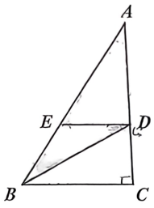

15. （2025八上·北京期中）如图，$BD$ 是 $\triangle ABC$ 的角平分线，过点 $D$ 作 $DE\parallel BC$ 交 $AB$ 于点 $E$。若 $\angle A=36^{\circ}$，$\angle BDC=76^{\circ}$，则 $\angle BDE=$ ___ $^{\circ}$。

> [!question]- 点击查看答案与解析
> 【答案】40
> 
> 【考点】三角形的外角 → [[【初中数学知识点体系-人教版】#13-3 三角形的内角与外角]]、角平分线加平行线 → [[【初中数学知识点体系-人教版】#14-3 角的平分线]]
> 
> 【解析】
> 设 $\angle ABD=\angle DBC=x$（$BD$ 平分 $\angle ABC$）。
> $\angle BDC$ 是 $\triangle ABD$ 的一个外角，所以 $\angle BDC=\angle A+\angle ABD$，
> 即 $76^{\circ}=36^{\circ}+x$，解得 $x=40^{\circ}$，故 $\angle DBC=40^{\circ}$。
> 因为 $DE\parallel BC$，所以 $\angle BDE=\angle DBC=40^{\circ}$（两直线平行，内错角相等）。
> 所以 $\angle BDE=40^{\circ}$。
> 
> 【易错点】不用外角定理而硬凑三角形内角和；$DE\parallel BC$ 得的是内错角 $\angle BDE=\angle DBC$，不要看成 $\angle BDE=\angle ABC$。
