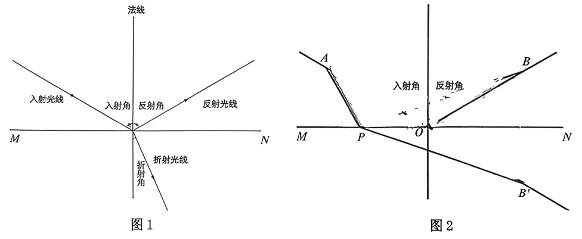

16. （2025八上·北京期中）如图 1，$MN$ 是光学性质不同的两个均匀媒质的分界面，当入射光线从第一媒质射到分界面时，形成反射光线和折射光线。反射光线传回第一媒质，折射光线进入第二媒质。入射光线与分界面的法线组成的角叫作入射角，反射光线、折射光线与分界面的法线组成的角分别叫作反射角、折射角。根据光线的反射定律，入射角总是等于反射角。1657 年，法国数学家费马提出著名的光行最速原理：当光线行进时入射角等于反射角，光行进的时间最短，由于是在同一媒质中传播，也就是光线行进的“光程”最短。

此原理是可以用数学方法证明的：如图 2，光线经过点 $A$ 射向分界面上的点 $O$，反射经过点 $B$，如果沿着入射角等于反射角的路径行进时，可以证明要比其他路径（如沿着路径 $APB$）短。若作点 $B$ 关于分界面 $MN$ 的对称点 $B'$，连接 $OB'$，请结合证明过程选出下面结论中正确的，将序号填写在横线上 ___ ，

$①$ 点 $A$，$O$，$B'$ 三点共线；$②$ $OB=OB'$；$③$ $PB=PB'$；$④$ $AP+BP<AO+OB$

> [!question]- 点击查看答案与解析
> 【答案】①②③
> 
> 【考点】轴对称的性质与“光程最短”→ [[【初中数学知识点体系-人教版】#15-2 画轴对称的图形]]、三角形三边关系 → [[【初中数学知识点体系-人教版】#13-2 与三角形有关的线段]]
> 
> 【解析】
> 点 $B'$ 是 $B$ 关于分界面 $MN$ 的对称点，而 $O$、$P$ 都在 $MN$ 上，
> 由轴对称的性质得 $OB=OB'$、$PB=PB'$，所以 ②③ 都正确。
> 入射角等于反射角，说明 $AO$ 与 $OB$ 关于 $MN$ 的法线对称；而 $OB'$ 与 $OB$ 也关于 $MN$ 对称，
> 所以 $AO$ 与 $OB'$ 位于同一条直线上，$A$、$O$、$B'$ 三点共线，① 正确。
> 于是 $AO+OB=AO+OB'=AB'$；而 $AP+BP=AP+PB'$，当 $P$ 不在直线 $AB'$ 上时，
> 由三角形两边之和大于第三边得 $AP+PB'>AB'=AO+OB$，即 $AP+BP>AO+OB$，④ 错误。
> 所以正确的是 ①②③。
> 
> 【易错点】把 ④ 的不等号方向记反（应为 $AP+BP>AO+OB$）；只看“对称”就漏判 ① 的共线。
