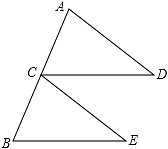

18. （2025八上·北京期中）已知：如图，点 $C$ 为 $AB$ 中点，$CD=BE$，$CD\parallel BE$。求证：$\triangle ACD\cong\triangle CBE$。

> [!question]- 点击查看答案与解析
> 【答案】证明见解析
> 
> 【考点】三角形全等的判定（SAS）→ [[【初中数学知识点体系-人教版】#14-2 三角形全等的判定]]
> 
> 【解析】
> 证明：
> $\because$ 点 $C$ 为 $AB$ 的中点，
> $\therefore AC=CB$。
> $\because CD\parallel BE$，
> $\therefore \angle ACD=\angle CBE$（两直线平行，同位角相等）。
> 又 $\because CD=BE$，
> $\therefore$ 在 $\triangle ACD$ 与 $\triangle CBE$ 中，
> $\quad AC=CB$，$\angle ACD=\angle CBE$，$CD=BE$，
> $\therefore \triangle ACD\cong\triangle CBE$（$SAS$）。
> 
> 【易错点】用 $CD\parallel BE$ 得出 $\angle ADC=\angle CEB$（内错角）却与 $CD=BE$ 配错对应边；把全等写成 $\triangle ACD\cong\triangle BCE$（对应顶点顺序错）。
