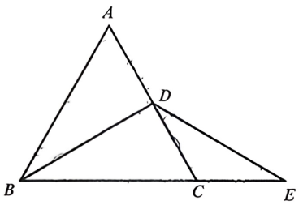

20. （2025八上·北京期中）如图，$\triangle ABC$ 是等边三角形，$BD$ 是中线，延长 $BC$ 至 $E$，使 $CE=CD$。求 $\angle BDE$ 的度数。

> [!question]- 点击查看答案与解析
> 【答案】$120^{\circ}$
> 
> 【考点】等边三角形的性质 → [[【初中数学知识点体系-人教版】#15-3 等腰三角形]]、三角形的内角与外角 → [[【初中数学知识点体系-人教版】#13-3 三角形的内角与外角]]
> 
> 【解析】
> $\because \triangle ABC$ 是等边三角形，
> $\therefore \angle ABC=\angle ACB=60^{\circ}$，且 $BD$ 是中线也是高，$\therefore \angle BDC=90^{\circ}$。
> $\because$ 点 $E$ 在 $BC$ 的延长线上，
> $\therefore \angle DCE=180^{\circ}-\angle ACB=120^{\circ}$。
> $\because CE=CD$，
> $\therefore \angle CDE=\angle CED=\dfrac{180^{\circ}-120^{\circ}}{2}=30^{\circ}$。
> $\therefore \angle BDE=\angle BDC+\angle CDE=90^{\circ}+30^{\circ}=120^{\circ}$。
> 
> 【易错点】忘记“等边三角形中线也是高”而得不到 $\angle BDC=90^{\circ}$；把 $\angle DCE$ 误当成 $60^{\circ}$（点 $E$ 在 $BC$ 的延长线上，邻补角是 $120^{\circ}$），从而算出 $60^{\circ}$。
