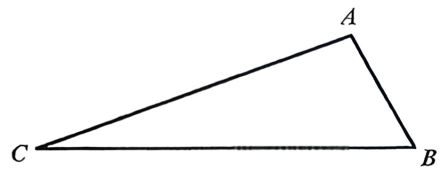
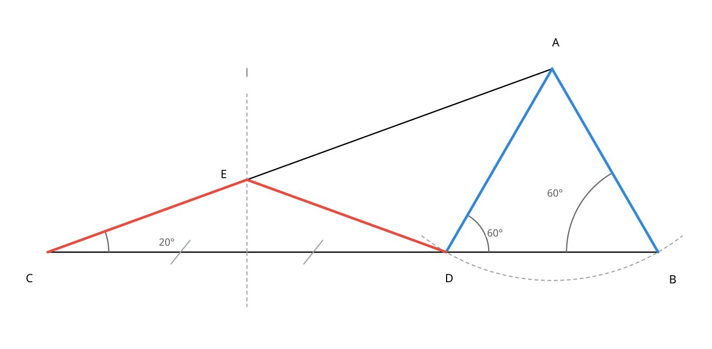

21. （2025八上·北京期中）小兵遇到一个作图问题：如图，在 $\triangle ABC$ 中，$\angle B=3\angle C$，如何用尺规作图把 $\triangle ABC$ 分成三个等腰三角形。

下面是小兵设计的尺规作图过程。

作法：$①$ 以点 $A$ 为圆心，$AB$ 长为半径作弧，交线段 $BC$ 于另一点 $D$；

$②$ 作线段 $CD$ 的垂直平分线 $l$，直线 $l$ 交线段 $AC$ 于点 $E$；

$③$ 连接 $AD$，$DE$，则 $\triangle ABD$，$\triangle ADE$，$\triangle CDE$ 即为所求的等腰三角形。

根据小兵设计的尺规作图过程，

（1）使用直尺和圆规，补全图形；（保留作图痕迹）

（2）完成下面的证明。

证明：由作图可知 $AB=AD$，

$\therefore \angle B=$ ___ 。$①$

$\because \angle B=3\angle C$，

$\therefore \angle ADB=3\angle C$。

$\because$ 直线 $l$ 为线段 $CD$ 的垂直平分线，

$\therefore CE=DE$（ ___ ）（填推理的依据）。$②$

$\therefore \angle C=\angle CDE$。

$\therefore \angle AED=\angle C+\angle CDE=2\angle C$

$\because \angle ADB=\angle C+\angle CAD=3\angle C$，

$\therefore \angle CAD=\angle ADB-\angle C=2\angle C$。

$\therefore \angle AED=\angle CAD$。

$\therefore AD=DE$（ ___ ）（填推理的依据）。$③$

$\therefore \triangle ABD$，$\triangle ADE$，$\triangle CDE$ 均为等腰三角形。

> [!question]- 点击查看答案与解析
> 【答案】（1）作图略（保留弧与垂直平分线的痕迹）　（2）① $\angle ADB$　② 线段垂直平分线上的点到线段两端点的距离相等　③ 等角对等边
> 
> 【考点】等腰三角形的判定（等角对等边）→ [[【初中数学知识点体系-人教版】#15-3 等腰三角形]]、线段垂直平分线的性质 → [[【初中数学知识点体系-人教版】#15-1 图形的轴对称]]
> 
> 【解析】
> （1）如图，以点 $A$ 为圆心、$AB$ 长为半径画弧，交线段 $BC$ 于另一点 $D$；作线段 $CD$ 的垂直平分线 $l$，交 $AC$ 于点 $E$；连接 $AD$、$DE$（作图痕迹要保留）。
> （2）由作图可知 $AB=AD$，
> $\therefore \angle B=\angle ADB$（等边对等角），① 填 $\angle ADB$。
> $\because$ 直线 $l$ 为线段 $CD$ 的垂直平分线，
> $\therefore CE=DE$（线段垂直平分线上的点到线段两端点的距离相等），② 填这条性质。
> $\therefore \angle C=\angle CDE$，$\angle AED=\angle C+\angle CDE=2\angle C$。
> $\because \angle ADB=\angle C+\angle CAD=3\angle C$，
> $\therefore \angle CAD=3\angle C-\angle C=2\angle C$，
> $\therefore \angle AED=\angle CAD$，
> $\therefore AD=DE$（等角对等边），③ 填“等角对等边”。
> 于是 $\triangle ABD$、$\triangle ADE$、$\triangle CDE$ 都是等腰三角形。
> 
> 
> 
> 【易错点】② 只写“垂直平分线”而不写完整性质（判分要求写出“到线段两端点的距离相等”）；③ 把依据写成“等边对等角”，方向恰好相反。
