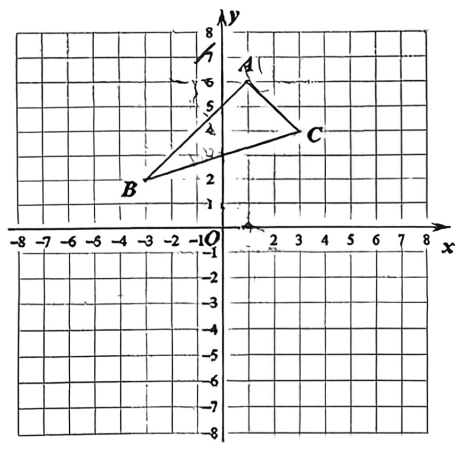
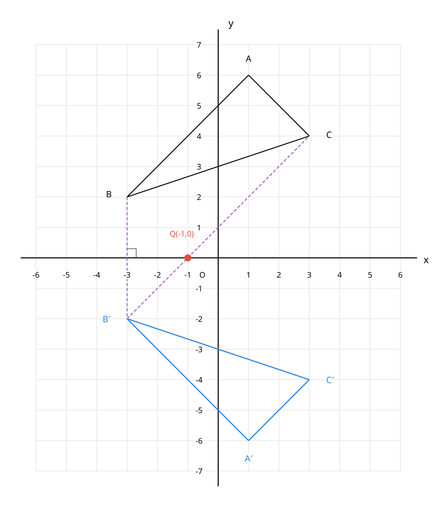

22. （2025八上·北京期中）如图，在平面直角坐标系中，$\triangle ABC$ 各顶点的坐标分别为：$A(1,6)$，$B(-3,2)$，$C(3,4)$

（1）在图中作 $\triangle A'B'C'$，使 $\triangle A'B'C'$ 和 $\triangle ABC$ 关于 $x$ 轴对称；

（2）写出点 $C$ 关于 $y$ 轴的对称点的坐标 ___ ；

（3）点 $Q$ 是 $x$ 轴上的一个动点，当 $\triangle QBC$ 的周长最小时，在图中画出点 $Q$ 的位置，并写出 $Q$ 点的坐标为 ___ 。

> [!question]- 点击查看答案与解析
> 【答案】（1）作图略，$A'(1,-6)$、$B'(-3,-2)$、$C'(3,-4)$　（2）$(-3,4)$　（3）$Q(-1,0)$
> 
> 【考点】坐标平面内作轴对称图形 → [[【初中数学知识点体系-人教版】#15-2 画轴对称的图形]]、最短路径（将军饮马）→ [[【初中数学知识点体系-人教版】#15-2 画轴对称的图形]]
> 
> 【解析】
> （1）如图，关于 $x$ 轴对称，横坐标不变、纵坐标变为相反数：
> $A(1,6)\to A'(1,-6)$，$B(-3,2)\to B'(-3,-2)$，$C(3,4)\to C'(3,-4)$，顺次连接 $A'$、$B'$、$C'$ 即得 $\triangle A'B'C'$。
> （2）关于 $y$ 轴对称，纵坐标不变、横坐标变为相反数，所以点 $C(3,4)$ 的对称点为 $(-3,4)$。
> （3）$\triangle QBC$ 的周长 $=QB+QC+BC$，其中 $BC$ 长度固定，只需 $QB+QC$ 最小。
> 作点 $B$ 关于 $x$ 轴的对称点 $B'(-3,-2)$，连接 $B'C$ 交 $x$ 轴于点 $Q$，则 $QB=QB'$，
> $QB+QC=QB'+QC\geqslant B'C$，当 $B'$、$Q$、$C$ 三点共线时取到最小值。
> 直线 $B'C$ 经过 $(-3,-2)$、$(3,4)$，斜率为 $1$，解析式为 $y=x+1$，令 $y=0$ 得 $x=-1$，
> 所以 $Q(-1,0)$。
> 
> 
> 
> 【易错点】（2）误把“关于 $y$ 轴对称”做成关于 $x$ 轴对称；（3）把 $Q$ 的对称点选成 $C$ 的对称点（应作 $B$ 关于 $x$ 轴的对称点，因为 $QC$ 与 $Q$ 同在 $x$ 轴一侧），或把 $Q$ 坐标写成 $(0,-1)$。
