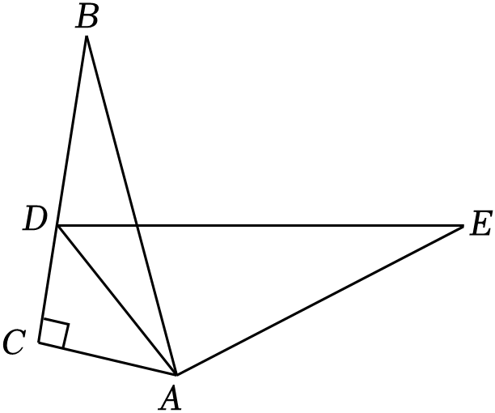
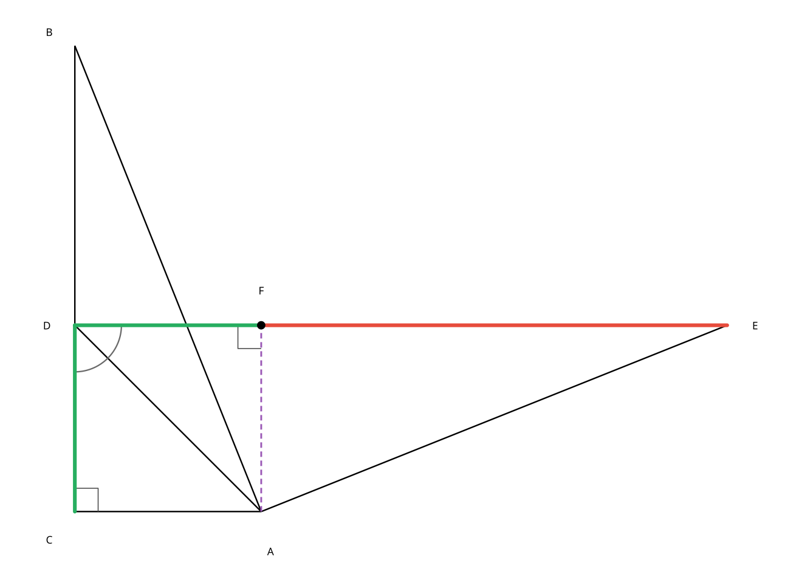

23. （2025八上·北京期中）如图，在 $\triangle ABC$ 中，$\angle ACB=90^{\circ}$，$D$ 为 $BC$ 边上一点，$DA$ 平分 $\angle CDE$，且 $AB=AE$，若 $CD=2$，$BD=3$，求 $DE$ 的长。

> [!question]- 点击查看答案与解析
> 【答案】$DE=7$
> 
> 【考点】角平分线的性质 → [[【初中数学知识点体系-人教版】#14-3 角的平分线]]、直角三角形全等（$HL$）→ [[【初中数学知识点体系-人教版】#14-2 三角形全等的判定]]
> 
> 【解析】
> 如图，过点 $A$ 作 $AF\perp DE$ 于 $F$。
> $\because DA$ 平分 $\angle CDE$，
> $\therefore \angle CDA=\angle FDA$。
> 又 $\angle ACD=\angle AFD=90^{\circ}$，$AD$ 为公共边，
> $\therefore \triangle ACD\cong\triangle AFD$（$AAS$），$\therefore AC=AF$，$CD=DF=2$。
> $\because AB=AE$，$AC=AF$，$\angle ACB=\angle AFE=90^{\circ}$，
> $\therefore Rt\triangle ABC\cong Rt\triangle AFE$（$HL$），$\therefore BC=FE$。
> 而 $BC=BD+DC=3+2=5$，
> $\therefore FE=5$，
> $\therefore DE=DF+FE=2+5=7$。
> 
> 
> 
> 【易错点】不作辅助线而直接猜 $DE=BD$ 或 $DE=BC$；$HL$ 判定漏写“两个直角三角形”的前提；忘记 $CD=DF$、$BC=FE$ 的对应关系。
