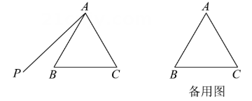
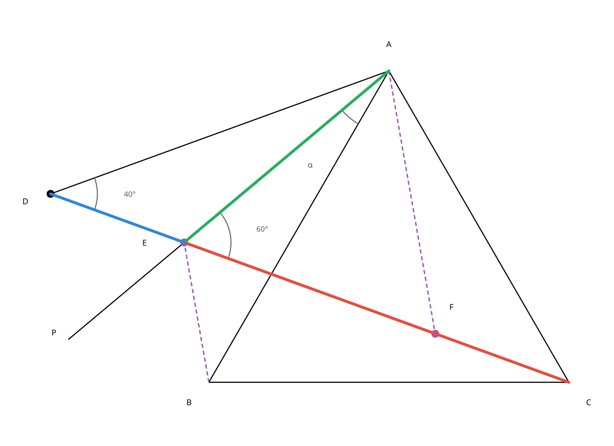

25. （2025八上·北京期中）如图，$\triangle ABC$ 为等边三角形，在 $\triangle ABC$ 的外侧作射线 $AP$，$\angle BAP=\alpha$（$0^{\circ}<\alpha<90^{\circ}$），点 $B$ 关于射线 $AP$ 的对称点为点 $D$，连接 $AD$，$CD$ 交直线 $AP$ 于点 $E$。

（1）依题意补全图形；

（2）当 $\alpha=20^{\circ}$，$\angle ADC=$ ___ $^{\circ}$；

（3）当 $0^{\circ}<\alpha<60^{\circ}$ 时，用等式表示 $AE$，$BE$，$CD$ 之间的数量关系，并证明；

（4）若 $\triangle DBC$ 为等腰三角形，直接写出 $\alpha$ 的度数 ___ 。

> [!question]- 点击查看答案与解析
> 【答案】（1）作图略　（2）$40$　（3）$CD=AE+2BE$　（4）$30^{\circ}$ 或 $75^{\circ}$
> 
> 【考点】轴对称（对称点的性质）→ [[【初中数学知识点体系-人教版】#15-1 图形的轴对称]]、等腰三角形的性质与判定 → [[【初中数学知识点体系-人教版】#15-3 等腰三角形]]、三角形全等（$SAS$）→ [[【初中数学知识点体系-人教版】#14-2 三角形全等的判定]]
> 
> 【解析】
> （1）作点 $B$ 关于射线 $AP$ 的对称点 $D$，连接 $AD$，$CD$ 交直线 $AP$ 于点 $E$。
> （2）由对称得 $AB=AD$，$\angle DAP=\angle BAP=20^{\circ}$，所以 $\angle DAB=40^{\circ}$。
> 又 $AB=AC$，$\angle BAC=60^{\circ}$，$\therefore AD=AC$，$\angle DAC=60^{\circ}+40^{\circ}=100^{\circ}$，
> $\therefore \angle ADC=\dfrac{180^{\circ}-100^{\circ}}{2}=40^{\circ}$。
> （3）$CD=AE+2BE$。证明如下（如图）：
> ① $\because AD=AB=AC=BC$，$\angle DAC=60^{\circ}+2\alpha$，
> $\therefore \angle ACD=\angle ADC=\dfrac{180^{\circ}-(60^{\circ}+2\alpha)}{2}=60^{\circ}-\alpha$。
> 在 $\triangle ACE$ 中，$\angle CAE=60^{\circ}+\alpha$（$E$ 在 $AP$ 上），
> $\therefore \angle AEC=180^{\circ}-(60^{\circ}+\alpha)-(60^{\circ}-\alpha)=60^{\circ}$。
> ② $\because E$ 在 $AP$ 上，而 $AP$ 是 $B$、$D$ 的对称轴，
> $\therefore EB=ED$，$\angle BEA=\angle DEA$。
> $\because C$、$E$、$D$ 共线，$\therefore \angle DEA=180^{\circ}-\angle AEC=120^{\circ}$，
> $\therefore \angle BEA=120^{\circ}$。
> ③ 在 $CE$ 上取点 $F$，使 $EF=EA$。$\because \angle AEF=\angle AEC=60^{\circ}$，
> $\therefore \triangle AEF$ 是等边三角形，$\therefore AF=AE$，$\angle EAF=60^{\circ}$。
> $\because \angle CAE=60^{\circ}+\alpha$，$\angle EAF=60^{\circ}$，
> $\therefore \angle CAF=(60^{\circ}+\alpha)-60^{\circ}=\alpha=\angle BAE$。
> ④ 在 $\triangle ACF$ 与 $\triangle ABE$ 中，$AC=AB$，$\angle CAF=\angle BAE$，$AF=AE$，
> $\therefore \triangle ACF\cong\triangle ABE$（$SAS$），$\therefore CF=BE$。
> ⑤ $\therefore CE=EF+FC=AE+BE$，
> $\therefore CD=CE+ED=(AE+BE)+BE=AE+2BE$。
> （4）设等边三角形边长为 $s$，则 $BC=s$；
> 在等腰 $\triangle ABD$（$AD=AB=s$，顶角 $2\alpha$）中 $DB=2s\sin\alpha$；
> 在等腰 $\triangle ACD$（$AD=AC=s$，顶角 $60^{\circ}+2\alpha$）中 $DC=2s\sin(30^{\circ}+\alpha)$。
> - 若 $DB=BC$：$2\sin\alpha=1$，$\alpha=30^{\circ}$；
> - 若 $DB=DC$：$\sin\alpha=\sin(30^{\circ}+\alpha)$，由 $\alpha=180^{\circ}-(30^{\circ}+\alpha)$ 得 $\alpha=75^{\circ}$；
> - 若 $DC=BC$：$2\sin(30^{\circ}+\alpha)=1$，在 $0^{\circ}<\alpha<90^{\circ}$ 内无解。
> 所以 $\alpha=30^{\circ}$ 或 $75^{\circ}$。
> 
> 
> 
> 【易错点】（3）忘记“$AP$ 是 $BD$ 的垂直平分线”而得不到 $EB=ED$、$\angle BEA=\angle DEA$；辅助点 $F$ 取错位置（应在 $CE$ 上取 $EF=EA$，不是延长 $CE$）。（4）只讨论一种等腰情形，漏掉 $\alpha=75^{\circ}$。
