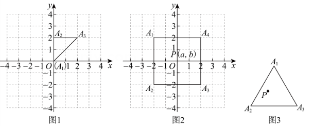
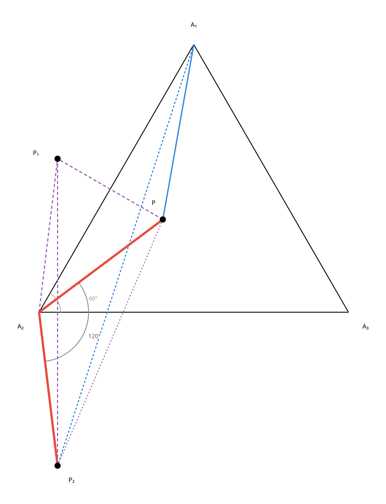

26. （2025八上·北京期中）在平面直角坐标系中，$S$ 是给定的 $n$（$n\ge 3$）边形 $A_{1}A_{2}\cdots A_{n}$。我们称如下的变换为一次“$S$-轴反射变换”：将平面内一点 $X$ 沿直线 $A_{1}A_{2}$ 进行翻折得到点 $X_{1}$；将点 $X_{1}$ 沿直线 $A_{2}A_{3}$ 翻折得到点 $X_{2}$；$\cdots$；将点 $X_{n-1}$ 沿直线 $A_{n}A_{1}$ 翻折最终得到点 $X_{n}$。并记点 $X_{n}$ 为点 $X$ 在“$S$-轴反射变换”下的像点。请回答下列问题：

（1）如图 1，若 $S$ 是给定的等腰直角三角形 $A_{1}A_{2}A_{3}$（$\angle A_{2}=90^{\circ}$），顶点坐标为 $A_{1}(0,0)$，$A_{2}(0,2)$，$A_{3}(2,2)$，则点 $M(1,0)$ 在此“$S$-轴反射变换”下的像点 $M_{3}$ 的坐标为 ___ ；

（2）如图 2，若 $S$ 是给定的四边形 $A_{1}A_{2}A_{3}A_{4}$，顶点坐标为 $A_{1}(-2,2)$，$A_{2}(-2,-2)$，$A_{3}(2,-2)$，$A_{4}(2,2)$，点 $B$ 在此“$S$-轴反射变换”下的像点 $B_{n}$ 的坐标是 $(9,7)$，则点 $B$ 的坐标为 ___ ；四边形内一点 $P(a,b)$ 的像点 $P_{4}$ 的坐标是 ___ （用含 $a$，$b$ 的代数式表示）；

（3）如图 3，若 $S$ 是给定的平面内一个等边三角形 $A_{1}A_{2}A_{3}$，点 $P$ 是此三角形内（不含边界）一点，对点 $P$ 进行一次“$S$-轴反射变换”得到点 $P_{3}$，是否存在点 $P$ 使得 $P_{3}$ 和 $P$ 重合？如果存在，请在图中给出点 $P$ 的具体位置；如果不存在，请说明理由。

> [!question]- 点击查看答案与解析
> 【答案】（1）$M_{3}(4,-1)$　（2）$B(1,-1)$；$P_{4}(a+8,\,b+8)$　（3）不存在，理由见解析
> 
> 【考点】图形的轴对称（对称点的坐标）→ [[【初中数学知识点体系-人教版】#15-1 图形的轴对称]]、画轴对称的图形 → [[【初中数学知识点体系-人教版】#15-2 画轴对称的图形]]
> 
> 【解析】
> （1）$A_{1}(0,0)$、$A_{2}(0,2)$ 所在直线为 $y$ 轴：$M(1,0)\to M_{1}(-1,0)$；
> $A_{2}(0,2)$、$A_{3}(2,2)$ 所在直线为 $y=2$：$M_{1}(-1,0)\to M_{2}(-1,4)$；
> $A_{3}(2,2)$、$A_{1}(0,0)$ 所在直线为 $y=x$：$M_{2}(-1,4)\to M_{3}(4,-1)$。
> 所以 $M_{3}(4,-1)$。
> （2）四条边所在直线依次为 $x=-2$、$y=-2$、$x=2$、$y=2$。
> 点 $P(a,b)$ 依次翻折：关于 $x=-2$ 得 $(-4-a,b)$，关于 $y=-2$ 得 $(-4-a,-4-b)$，
> 关于 $x=2$ 得 $(4-(-4-a),-4-b)=(a+8,-4-b)$，关于 $y=2$ 得 $(a+8,\,4-(-4-b))=(a+8,b+8)$。
> 所以 $P_{4}(a+8,b+8)$。
> $B$ 的像点为 $(9,7)$，由 $(a+8,b+8)=(9,7)$ 得 $B(1,-1)$。
> （3）不存在。理由（反证，如图）：
> 设 $P_{3}=P$。记 $P_{1}$ 为 $P$ 关于 $A_{1}A_{2}$ 的对称点，$P_{2}$ 为 $P_{1}$ 关于 $A_{2}A_{3}$ 的对称点。
> 由对称得 $A_{2}P_{1}=A_{2}P$，$\angle P_{1}A_{2}A_{1}=\angle PA_{2}A_{1}$；
> $A_{2}P_{2}=A_{2}P_{1}$，$\angle P_{2}A_{2}A_{3}=\angle P_{1}A_{2}A_{3}$。
> 两式相加得 $\angle PA_{2}P_{2}=2\angle A_{1}A_{2}A_{3}=120^{\circ}$，且 $A_{2}P=A_{2}P_{2}$。
> 又 $P_{3}=P$ 说明 $A_{3}A_{1}$ 是 $PP_{2}$ 的垂直平分线，$\therefore A_{1}P=A_{1}P_{2}$。
> 在 $\triangle A_{1}A_{2}P$ 与 $\triangle A_{1}A_{2}P_{2}$ 中：$A_{1}A_{2}$ 公共，$A_{2}P=A_{2}P_{2}$，$A_{1}P=A_{1}P_{2}$，
> $\therefore \triangle A_{1}A_{2}P\cong\triangle A_{1}A_{2}P_{2}$（$SSS$），$\therefore \angle PA_{2}A_{1}=\angle P_{2}A_{2}A_{1}$。
> 于是射线 $A_{2}P$ 与 $A_{2}P_{2}$ 或者重合，或者关于 $A_{2}A_{1}$ 对称：
> 若重合，则 $\angle PA_{2}P_{2}=0^{\circ}$，与 $\angle PA_{2}P_{2}=120^{\circ}$ 矛盾；
> 若关于 $A_{2}A_{1}$ 对称，则 $2\angle PA_{2}A_{1}=120^{\circ}$，即 $\angle PA_{2}A_{1}=60^{\circ}$，此时 $P$ 落在边 $A_{2}A_{3}$ 上，与“$P$ 在三角形内部（不含边界）”矛盾。
> 所以不存在这样的点 $P$。
> 
> 
> 
> 【易错点】（2）中每完成一次翻折只改变一个坐标，容易漏改或多改（关于竖直线 $x=-2$ 只变横坐标，关于水平线 $y=-2$ 只变纵坐标）；（3）中只取几个特殊点试算就下结论，缺少“$SSS$ 全等 + 角相等”的推理。
