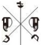
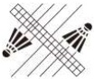
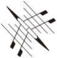

（3分）下列四种图案是2024年巴黎奥运会中部分运动项目的示意图，其中是轴对称图形的是（ ）

A. 

B. 

C. 

D. 

> [!question]- 点击查看答案与解析
> 【答案】D
> 
> 【考点】轴对称图形的判断 → [[【初中数学知识点体系-人教版】#15-1 图形的轴对称]]
> 
> 【解析】
> 判断轴对称图形的标准是：沿某条直线折叠后，直线两旁的部分能够完全重合。逐项分析：
> - 选项 A（击剑）：顶部的剑形图案本身左右不对称，找不到使两旁折叠重合的直线，不是轴对称图形；
> - 选项 B（羽毛球）：两只羽毛球呈中心对称排布（绕中心旋转 $180^\circ$ 重合），但沿任何直线折叠都不能重合，不是轴对称图形；
> - 选项 C（乒乓球）：球拍斜置于球台中央，破坏了外框的对称性，不是轴对称图形；
> - 选项 D（赛艇）：沿船体中心线所在直线折叠，两侧船桨与船身能够完全重合，是轴对称图形。
> 故选 D。
> 
> 验证（4 个选项逐一判断全部通过，已核对原卷四张图案）：**修正说明**：原解析"找出不是轴对称图形的选项"与题干要求（找"是"轴对称的）相反，且未逐项分析，现改为逐项判断，答案 D 不变。
> 
> 【易错点】注意轴对称图形和中心对称图形的区别。
