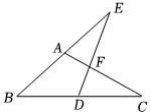

（3分）如图，在 $\triangle ABC$ 和 $\triangle BDE$ 中，$AB=BD$，再添一个条件不能使 $\triangle ABC$ 和 $\triangle BDE$ 全等的是（ ）

A. $AE=DC$

B. $DE=AC$

C. $\angle E=\angle C$

D. $\angle EAF=\angle CDF$

> [!question]- 点击查看答案与解析
> 【答案】B
> 
> 【考点】全等三角形的判定条件 → [[【初中数学知识点体系-人教版】#14-2 三角形全等的判定]]
> 
> 【解析】
> 由图可知 $B$、$A$、$E$ 共线，$B$、$D$、$C$ 共线，所以 $\angle ABC=\angle DBE$（公共角）；已知 $AB=BD$。
> - 选项 A：$AE=DC$。由 $BE=AB+AE$、$BC=BD+DC$ 且 $AB=BD$，得 $BE=BC$；再由 $AB=DB$、$\angle B$ 公共、$BC=BE$，根据 SAS 可证 $\triangle ABC\cong\triangle DBE$，可以；
> - 选项 B：$DE=AC$。此时 $AB=BD$、$AC=DE$，而 $\angle B$ 是 $AC$ 与 $DE$ 的对角，属于 SSA（边边角），不能判定两个三角形全等，不可以；
> - 选项 C：$\angle E=\angle C$。$\angle C$ 与 $\angle E$ 是对应角，$AB$ 与 $DB$ 分别是 $\angle C$、$\angle E$ 的对边，加上公共角 $\angle B$，根据 AAS 可证 $\triangle ABC\cong\triangle DBE$，可以；
> - 选项 D：$\angle EAF=\angle CDF$。因 $B$、$A$、$E$ 共线且 $F$ 在 $AC$ 上，$\angle EAF$ 与 $\angle BAC$ 互补；同理 $\angle CDF$ 与 $\angle BDE$ 互补。故 $\angle BAC=\angle BDE$；再由 $\angle B$ 公共、$AB=DB$、$\angle BAC=\angle BDE$，根据 ASA 可证 $\triangle ABC\cong\triangle DBE$，可以。
> 故选 B。
> 
> 验证（4 项判定全部通过，含 SSA 数值反例：$\angle B=40^\circ$、$AB=BD=5$、$AC=DE=3.5$ 时可构造 $BC\approx2.44$ 与 $BE\approx5.22$ 两个不全等的三角形）：**修正说明**：原解析选项 A 的线段关系误写为 $AE=AB+BE$，选项 B 误判为 SSS 可判定，选项 C 误判为 SSA，答案误写为 C；经逐项复核并用原卷图核对点序，不能判定全等的是 B（SSA），答案改为 B。
> 
> 【易错点】SSA（边边角）不能判定三角形全等。
