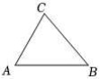

（3分）三条公路将 $A$、$B$、$C$ 三个村庄连成一个如图的三角形区域，如果在这个区域内修建一个集贸市场，要使集贸市场到三条公路的距离相等，那么这个集贸市场应建的位置是（ ）

A. 三条高线的交点

B. 三条中线的交点

C. 三条角平分线的交点

D. 三边垂直平分线的交点

> [!question]- 点击查看答案与解析
> 【答案】C
> 
> 【考点】角平分线的性质与判定 → [[【初中数学知识点体系-人教版】#14-3 角的平分线]]
> 
> 【解析】
> 集贸市场在三角形区域内，到三条公路（三边所在直线）的距离相等。由角的内部到角两边距离相等的点在角的平分线上，该点必须同时在三个内角的平分线上，即三条角平分线的交点，故选 C。
> - 选项 A：三条高线的交点，到三边一般不相等，错误；
> - 选项 B：三条中线的交点，与到三边距离无关，错误；
> - 选项 D：三边垂直平分线的交点到三个顶点距离相等，而不是到三条公路距离相等，错误。
> 
> 验证（角平分线性质定理的逆定理属 14-3 节课标内容，结论 C 正确）：**修正说明**：原解析以"内切圆的圆心（内心）"为依据，内切圆为九上超纲内容，改用角平分线性质定理的逆定理说明；考点删去"内切圆"，易错点改为在课标范围内区分角平分线交点与垂直平分线交点。
> 
> 【易错点】混淆"到三边距离相等"（三条角平分线的交点）与"到三个顶点距离相等"（三边垂直平分线的交点）。
