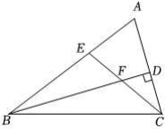

（3分）如图，在 $\triangle ABC$ 中，$BD$ 是 $AC$ 边上的高，$CE$ 是 $\angle ACB$ 的平分线，$BD$，$CE$ 交于点 $F$。若 $\angle AEC=80^{\circ}$，$\angle BFC=128^{\circ}$，则 $\angle ABC$ 的度数是（ ）

A. $28^{\circ}$

B. $38^{\circ}$

C. $42^{\circ}$

D. $62^{\circ}$

> [!question]- 点击查看答案与解析
> 【答案】C
> 
> 【考点】三角形的高、角平分线与角度计算 → [[【初中数学知识点体系-人教版】#13-3 三角形的内角与外角]]、[[【初中数学知识点体系-人教版】#14-3 角的平分线]]
> 
> 【解析】
> 在 $\triangle ABC$ 中，$BD$ 是 $AC$ 边上的高（$\angle BDA=\angle BDC=90^{\circ}$），$CE$ 是 $\angle ACB$ 的平分线。
> 在 $\triangle BFC$ 中，$\angle BFC=128^{\circ}$，$\angle FBC+\angle FCB=180^{\circ}-128^{\circ}=52^{\circ}$。
> 设 $\angle ACE=\angle BCE=\alpha$，则 $\angle FCB=\alpha$。
> 在 $\triangle AEC$ 中，$\angle AEC=80^{\circ}$，$\angle EAC+\angle ACE=180^{\circ}-80^{\circ}=100^{\circ}$，即 $\angle A+\alpha=100^{\circ}$。
> 在 $\triangle ABD$ 中，$\angle ABD=90^{\circ}-\angle A$。
> $\angle FBC=52^{\circ}-\alpha$。
> $\angle ABC=\angle ABD+\angle FBC=(90^{\circ}-(100^{\circ}-\alpha))+(52^{\circ}-\alpha)=(\alpha-10^{\circ})+(52^{\circ}-\alpha)=42^{\circ}$。
> 故选 C。
> 
> 【易错点】高线和角平分线组合题需设未知数联立求解。
