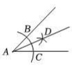
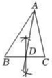
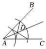

（3分）在如图的三个图形中，根据尺规作图的痕迹，能判断射线 $AD$ 平分 $\angle BAC$ 的是（ ）

$①$ 

$②$ 

$③$ 

A. $①②$

B. $①③$

C. $②③$

D. 只有 $①$

> [!question]- 点击查看答案与解析
> 【答案】B（$①③$）
> 
> 【考点】角平分线的尺规作图 → [[【初中数学知识点体系-人教版】#14-3 角的平分线]]
> 
> 【解析】
> 图$①$：以 $A$ 为圆心画弧交角两边于 $B$、$C$（$AB=AC$），再分别以 $B$、$C$ 为圆心、相同半径画弧交于 $D$（$BD=CD$），连 $AD$。由 $AB=AC$、$BD=CD$、$AD=AD$，SSS 可证 $\triangle ABD\cong\triangle ACD$，得 $\angle BAD=\angle CAD$，能判断；
> 图$②$：作图痕迹是分别以 $B$、$C$ 为圆心、大于 $\frac12 BC$ 的同长两弧相交，连线后与 $BC$ 交于 $D$——这是线段 $BC$ 的垂直平分线作法，$D$ 是 $BC$ 的中点，$AD$ 只是 $\triangle ABC$ 的中线。只有当 $AB=AC$ 时中线才与角平分线重合，图中 $AB\ne AC$，不能判断；
> 图$③$：以 $A$ 为圆心画两条弧，在角的两边上分别截得两组等距点（$AM=AN$、$AP=AQ$），再以两边上的交点为圆心、等半径作弧（连线）交于 $D$。由对称的两组全等（先 SAS 证两边大三角形全等，再 AAS 证小三角形全等得 $DM=DN$，最后 SSS 证 $\triangle AMD\cong\triangle AND$）可得 $\angle MAD=\angle NAD$，能判断。
> 故选 B（$①③$）。
> 
> 验证（三幅作图痕迹已逐图核对原卷：$①$ 标准角平分线作法、$②$ $BC$ 垂直平分线痕迹、$③$ 两组等距截取+交叉作图可两步证全等，结论 $①③$ 正确）：**修正说明**：原解析对图$②$未指出痕迹实为 $BC$ 的垂直平分线（$AD$ 仅为中线）这一关键理由，对图$③$误述为"取等距点再作垂线"（图中无垂线），现按原卷作图痕迹重写说理，答案 B 不变。
> 
> 【易错点】需理解每种尺规作图痕迹背后的几何原理。
