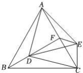

（3分）如图，边长为 4 的等边 $\triangle ABC$，$F$ 是边 $AC$ 的中点，点 $D$ 是线段 $BF$ 上的动点，连接 $AD$，在 $AD$ 的右侧作等边 $\triangle ADE$，连接 $CD$，$CE$，$EF$，给出如下结论：

$①$ $BF \perp AC$；

$②$ $\angle DEC=\angle DCE$；

$③$ $AE=CD$；

$④$ $\triangle ADE$ 的周长最小值为 6；

$⑤$ 当 $\triangle AEF$ 周长最小时，$\angle AFE=60^{\circ}$；

$⑥$ $\angle ACE$ 的大小随着点 $D$ 的移动而变化。

上述结论中正确的有（ ）个。

A. 3

B. 4

C. 5

D. 6

> [!question]- 点击查看答案与解析
> 【答案】B（4个正确）
> 
> 【考点】等边三角形的性质、全等三角形、动点最值 → [[【初中数学知识点体系-人教版】#15-1 图形的轴对称]]、[[【初中数学知识点体系-人教版】#15-3 等腰三角形]]、[[【初中数学知识点体系-人教版】#14-2 三角形全等的判定]]
> 
> 【解析】
> 等边 $\triangle ABC$ 边长为4，$F$ 为 $AC$ 中点，$D$ 为 $BF$ 上动点，$\triangle ADE$ 为等边三角形。
> $①$ $BF\perp AC$：等边三角形中线即高，正确；
> $②$ $\angle DEC=\angle DCE$：由 $\triangle ABD\cong\triangle ACE$（SAS：$AB=AC$，$\angle BAD=\angle CAE$（都等于 $60^\circ-\angle DAC$），$AD=AE$），得 $BD=CE$。又 $\triangle ADE$ 等边，$DE=AD$；而 $D$ 在 $AC$ 的垂直平分线 $BF$ 上，$DC=AD$，故 $DE=DC$，$\angle DEC=\angle DCE$，正确；
> $③$ $AE=CD$：$BF$ 是 $AC$ 的垂直平分线（$BA=BC$、$FA=FC$），所以 $DA=DC$；又 $AE=AD$，故 $AE=CD$，正确；
> $④$ $\triangle ADE$ 周长最小值：周长 $=3AD$。$AD$ 最小值在 $D=F$ 时取到（$BF$ 上离 $A$ 最近的点），$AD_{\min}=AF=2$，周长最小值 $=6$，正确；
> $⑤$ $\triangle AEF$ 周长 $=AE+EF+AF$，其中 $AF=2$ 为定值，只需 $AE+EF$ 最小。由 $⑥$，$E$ 始终在以 $C$ 为端点、与 $CA$ 成 $30^\circ$ 的定射线上。作 $F$ 关于该射线所在直线的对称点 $F'$，则 $AE+EF=AE+EF'\ge AF'$，当 $A$、$E$、$F'$ 共线时最小，此时 $E$ 恰在直线 $BF$ 上，$\angle AFE=90^{\circ}\neq60^{\circ}$，错误（注意最小位置不是 $D=F$：$D=F$ 时周长为 $6$，而最小周长为 $2+2\sqrt3<6$）；
> $⑥$ $\angle ACE$ 的大小随着点 $D$ 的移动而变化：由 $\triangle ABD\cong\triangle ACE$，$\angle ACE=\angle ABD=30^{\circ}$（$BF$ 平分 $\angle ABC$）为定值，不变化，错误。
> 正确的有 $①②③④$，共4个，选B。
> 
> 验证（坐标法 $A(-2,0)$、$C(2,0)$、$B(0,2\sqrt3)$、$D(0,d)$ 逐项核验六条结论：$①②③④$ 正确、$⑤⑥$ 错误；$\triangle AEF$ 周长 $P(d)=\sqrt{4+d^2}+\sqrt{d^2-2\sqrt3 d+4}+2$，在 $d=\frac{2\sqrt3}{3}$ 处取最小值 $2+2\sqrt3$，此时 $E\left(0,-\frac{2\sqrt3}{3}\right)$ 在直线 $BF$ 上、$\angle AFE=90^\circ$；$D=F$ 处 $P=6$、$\angle AFE=60^\circ$）：**修正说明**：原解析对 $⑤$ 称"当 $D=F$ 时周长最小、此时 $\angle AFE=90^\circ$"，两处均不成立（$D=F$ 时 $\angle AFE=60^\circ$，且该处并非最小），现改为轴对称最短路径说理；$③$ 补充"$BF$ 是 $AC$ 垂直平分线"的依据。$⑤$ 错误的结论与答案 B 不变。
> 
> 【易错点】等边三角形中构造旋转全等是核心方法；动点最值需利用"垂线段最短"。
