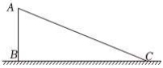

（2分）如图所示，有一根高为 $18$ 米（垂直于地面）的松树在 $A$ 处断裂，松树顶部落在地面 $C$ 处，通过测量可知 $\angle ACB=30^{\circ}$，则松树断裂处 $A$ 离地面的距离 $AB$ 的长为 ___ 米。

> [!question]- 点击查看答案与解析
> 【答案】6
> 
> 【考点】含 $30^\circ$ 角的直角三角形的性质 → [[【初中数学知识点体系-人教版】#15-3 等腰三角形]]
> 
> 【解析】
> 设 $AB=x$ 米，则断裂后倒下的部分 $AC=(18-x)$ 米。在直角 $\triangle ABC$ 中，$\angle B=90^{\circ}$，$\angle ACB=30^{\circ}$。
> 由"在直角三角形中，如果一个锐角等于 $30^\circ$，那么它所对的直角边等于斜边的一半"，得 $AB=\frac12 AC$，即 $x=\frac{18-x}{2}$。
> 
> $2x=18-x$，$3x=18$，$x=6$。
> 
> 故 $AB=6$ 米。
> 
> 验证（$x=6$ 时 $AB=6$、$AC=12$，$AB=\frac12 AC$ 成立，树高 $6+12=18$ 米与题干一致）：**修正说明**：原解析使用 $\sin 30^\circ$（锐角三角函数为九年级内容，超八上课标），改用含 $30^\circ$ 角的直角三角形性质；该性质在知识点体系 15-3 等腰三角形 一节，考点锚点由 #13-3 改为 #15-3，frontmatter knowledge 同步更新，答案 6 不变。
> 
> 【易错点】需正确识别直角三角形中 $30^\circ$ 角所对的直角边与斜边（断裂倒下的部分 $AC$ 才是斜边，不是树的原高）。
