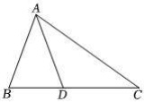

（2分）如图，在 $\triangle ABC$ 中，点 $D$ 在边 $BC$ 上，$AB=AD=DC$，$\angle C=36^{\circ}$，则 $\angle BAC=$ ___ 。

> [!question]- 点击查看答案与解析
> 【答案】$72^{\circ}$
> 
> 【考点】等腰三角形的性质与角度计算 → [[【初中数学知识点体系-人教版】#15-3 等腰三角形]]
> 
> 【解析】
> $\because AD=DC$，$\therefore \angle DAC=\angle C=36^{\circ}$。
> 
> $\angle ADC=180^{\circ}-36^{\circ}-36^{\circ}=108^{\circ}$。
> 
> $\angle ADB=180^{\circ}-108^{\circ}=72^{\circ}$。
> 
> $\because AB=AD$，$\therefore \angle ABD=\angle ADB=72^{\circ}$。
> 
> $\angle BAD=180^{\circ}-72^{\circ}-72^{\circ}=36^{\circ}$。
> 
> $\angle BAC=\angle BAD+\angle DAC=36^{\circ}+36^{\circ}=72^{\circ}$。
> 
> 【易错点】多个等腰三角形嵌套时需逐步推导角度。
