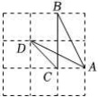

（2分）如图所示，点 $A$、$B$、$C$、$D$ 均在正方形网格格点上，则 $\angle ABC + \angle ADC =$ ___ 。

> [!question]- 点击查看答案与解析
> 【答案】$45^{\circ}$
> 
> 【考点】网格中的角度计算、全等三角形与等腰三角形 → [[【初中数学知识点体系-人教版】#13-3 三角形的内角与外角]]、[[【初中数学知识点体系-人教版】#14-2 三角形全等的判定]]
> 
> 【解析】
> 以格点建立方格（如图，$B$ 与 $D$ 相差一个 $1\times1$ 方格的对角线方向）。连接 $BD$。
> - $DB$、$DC$ 是两个 $1\times1$ 方格的对角线：由方格内两直角边对应相等的三角形全等（SAS）可得 $DB=DC$，且 $\angle BDC=90^\circ$（对角线与方格边成 $45^\circ$，两 $45^\circ$ 拼合），故 $\triangle BDC$ 是等腰直角三角形，$\angle DBC=45^\circ$；
> - $AB$、$AD$ 是两个 $1\times2$ 方格的对角线：同理由 SAS 全等得 $AB=AD$，故 $\angle ABD=\angle ADB$；
> - 设 $\angle ABC=x$。由图，射线 $BC$ 在 $\angle ABD$ 内部，故 $\angle ABD=x+45^\circ$，从而 $\angle ADB=x+45^\circ$；
> - 由图，射线 $DA$ 在 $\angle BDC$ 内部，故 $\angle ADC=\angle BDC-\angle ADB=90^\circ-(x+45^\circ)=45^\circ-x$。
> 所以 $\angle ABC+\angle ADC=x+(45^\circ-x)=45^{\circ}$。
> 
> 验证（按格点坐标 $B(2,3)$、$D(1,2)$、$C(2,1)$、$A(3,1)$ 数值计算：$\angle ABC\approx26.565^\circ$、$\angle ADC\approx18.435^\circ$，和恰为 $45^\circ$；$DB=DC$、$AB=AD$、$\angle BDC=90^\circ$、$\angle DBC=45^\circ$ 全部成立）：**修正说明**：原解析用"勾股定理或三角函数"（均为超八上课标内容）且无实质推导，答案误写为 $180^\circ$；经原卷图核对格点位置并数值验证，正确值为 $45^\circ$，解析改为课标内的全等+等腰直角三角形证法。
> 
> 【易错点】网格题中 $1\times1$、$1\times2$ 方格的对角线长相等关系应通过构造全等直角三角形获得（八上不能用勾股定理与三角函数）；注意识别射线 $BC$、$DA$ 的"内部"位置关系再作角的和差。
