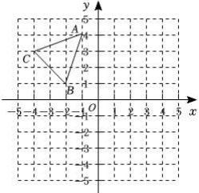

（3分）如图，在平面直角坐标系中，$\triangle ABC$ 的顶点 $A(-1,4)$，$B(-2,1)$，$C(-4,3)$。

（1）已知 $\triangle ABC$ 与 $\triangle A_1B_1C_1$ 关于 $y$ 轴对称，$\triangle A_1B_1C_1$ 与 $\triangle A_2B_2C_2$ 关于 $x$ 轴对称，请在坐标系中画出 $\triangle A_1B_1C_1$ 和 $\triangle A_2B_2C_2$；

（2）在 $y$ 轴上有一点 $P$，使得 $\triangle PA_1B_2$ 周长最短，请画出点 $P$ 的位置（保留画图的痕迹）。

> [!question]- 点击查看答案与解析
> 【答案】(1) 图略，$A_1(1,4)$，$B_1(2,1)$，$C_1(4,3)$，$A_2(1,-4)$，$B_2(2,-1)$，$C_2(4,-3)$；(2) 图略
> 
> 【考点】坐标对称与最短路径 → [[【初中数学知识点体系-人教版】#9-2 坐标方法的简单应用]]
> 
> 【解析】
> (1) 关于 $y$ 轴对称：$(x,y)\to(-x,y)$。$A(-1,4)\to A_1(1,4)$，$B(-2,1)\to B_1(2,1)$，$C(-4,3)\to C_1(4,3)$。
> 
> 关于 $x$ 轴对称：$(x,y)\to(x,-y)$。$A_1(1,4)\to A_2(1,-4)$，$B_1(2,1)\to B_2(2,-1)$，$C_1(4,3)\to C_2(4,-3)$。
> 
> (2) 使 $\triangle PA_1B_2$ 周长最短，即 $PA_1+PB_2+A_1B_2$ 最短。$A_1B_2$ 为定值，需 $PA_1+PB_2$ 最短。作 $A_1$ 关于 $y$ 轴的对称点 $A(-1,4)$，连 $AB_2$ 与 $y$ 轴的交点即为 $P$。
> 
> 【易错点】坐标对称变换时注意正负号。
