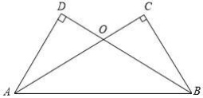

（5分）已知，如图，$AC \perp BC$，$BD \perp AD$，$AC$ 与 $BD$ 交于点 $O$，且 $AC=BD$。求证：$AO=BO$。

> [!question]- 点击查看答案与解析
> 【答案】证明见解析
> 
> 【考点】全等三角形的判定与性质 → [[【初中数学知识点体系-人教版】#14-1 全等三角形及其性质]]、[[【初中数学知识点体系-人教版】#14-2 三角形全等的判定]]
> 
> 【解析】
> $\because AC\perp BC$，$BD\perp AD$，$\therefore \angle C=\angle D=90^{\circ}$。
> 
> 在 Rt$\triangle ACB$ 和 Rt$\triangle BDA$ 中：
> $AB=BA$（公共边），$AC=BD$（已知），
> $\therefore$ Rt$\triangle ACB\cong$ Rt$\triangle BDA$（HL）。
> 
> $\therefore \angle CAB=\angle DBA$。
> 
> 在 $\triangle AOB$ 中，$\angle OAB=\angle OBA$，$\therefore AO=BO$。
> 
> 【易错点】直角三角形全等可用HL定理。
