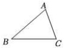

（5分）数学课上，李老师提出了如下问题：

尺规作图：作 $\triangle ABC$ 中 $BC$ 边上的高线。

已知：如图，$\triangle ABC$。

求作：$\triangle ABC$ 中 $BC$ 边上的高线 $AD$。

下面是小婷设计的"作 $\triangle ABC$ 中 $BC$ 边上的高线"的尺规作图过程。

作法：如图，

$①$ 以点 $B$ 为圆心，以 $BA$ 长为半径作弧，以点 $C$ 为圆心，以 $CA$ 长为半径作弧，两弧在 $BC$ 下方交于点 $E$；

$②$ 连接 $AE$ 交 $BC$ 于点 $D$，则线段 $AD$ 是 $\triangle ABC$ 中 $BC$ 边上的高线。

李老师肯定了小婷的作法，请你根据她设计的尺规作图过程，完成下列问题。

（1）使用直尺和圆规，补全图形。（保留作图痕迹）

（2）小齐和小郭两位同学对小婷的作法给出了证明，请将证明过程补充完整。

小齐证明：连接 $BE$，$CE$。$\because BE=BA$，$CE=CA$，$\therefore$ 点 $B$，$C$ 分别在线段 $AE$ 的垂直平分线上。（$①$ ___）$\therefore BC$ 垂直平分线段 $AE$。$\therefore$ 线段 $AD$ 是 $\triangle ABC$ 中 $BC$ 边上的高线。

小郭证明：连接 $BE$，$CE$。$\because BE=BA$，$CE=CA$，$BC=BC$，$\therefore\triangle ABC\cong\triangle EBC$。$\therefore\angle ABC=\angle EBC$。又 $\because BE=BA$，$\therefore BD\perp AE$。（$②$ ___）

（3）若 $AB=BC$，$\angle ABC=40^{\circ}$，则 $\angle CAE$ 的度数为 ___ 。

> [!question]- 点击查看答案与解析
> 【答案】(1) 图略；(2) ①到线段两端点距离相等的点在线段的垂直平分线上；②等腰三角形顶角的平分线也是底边上的高（三线合一）；(3) $20^{\circ}$
> 
> 【考点】垂直平分线的判定、全等三角形与等腰三角形三线合一 → [[【初中数学知识点体系-人教版】#15-1 图形的轴对称]]、[[【初中数学知识点体系-人教版】#14-2 三角形全等的判定]]、[[【初中数学知识点体系-人教版】#15-3 等腰三角形]]
> 
> 【解析】
> (2) 小齐证明中：$BE=BA$，$CE=CA$，$\therefore$ 点 $B$、$C$ 分别在线段 $AE$ 的垂直平分线上（到线段两端点距离相等的点在线段的垂直平分线上）。$\therefore BC$ 垂直平分 $AE$，$\therefore AD\perp BC$。
> 
> 小郭证明中：$\triangle ABC\cong\triangle EBC$（SSS），$\therefore\angle ABC=\angle EBC$。又 $BE=BA$，$\therefore\triangle ABE$ 为等腰三角形，$BD$ 为顶角平分线，$\therefore BD\perp AE$（等腰三角形顶角平分线、底边上的中线、底边上的高三线合一）。
> 
> (3) $AB=BC$，$\angle ABC=40^{\circ}$，$\therefore\angle BAC=\angle BCA=(180^{\circ}-40^{\circ})/2=70^{\circ}$。
> 
> $\because BA=BE$，$BC=CE$，$\triangle ABC\cong\triangle EBC$，$\therefore\angle EBC=\angle ABC=40^{\circ}$，$\angle EBA=80^{\circ}$。
> 
> $\triangle ABE$ 中，$BA=BE$，$\angle BAE=\angle BEA=(180^{\circ}-80^{\circ})/2=50^{\circ}$。
> 
> $\angle CAE=\angle BAC-\angle BAE=70^{\circ}-50^{\circ}=20^{\circ}$。
> 
> 验证（(2)①②理由与作图逻辑逐条核对：小郭由 $\angle ABC=\angle EBC$ 得 $BD$ 是等腰 $\triangle ABE$ 顶角 $\angle ABE$ 的平分线，用"顶角平分线即底边上的高"；(3) 独立验算 $\angle BAC=70^\circ$、$\angle BAE=50^\circ$、$\angle CAE=20^\circ$，原卷图核对一致）：**修正说明**：原【答案】②误写为"底边上的中线也是底边上的高"（证明中 $BD$ 是顶角平分线而非中线，解析正文本就写对），改为三线合一的正确表述；原【考点】称垂直平分线判定与等腰三角形性质却只链 #14-2，补链 #15-1（垂直平分线判定所在节）与 #15-3（三线合一所在节），frontmatter 删去与本题无关的 14-3。
> 
> 【易错点】垂直平分线的判定定理与三线合一性质的灵活运用；注意小郭证法中 $BD$ 是顶角平分线、小齐证法走垂直平分线判定，两条路线的理由不同。
