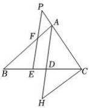

（5分）如图，在 $\triangle ABC$ 中，$AD$ 平分 $\angle BAC$，$E$ 是 $BC$ 上一点，$BE=CD$，$EF \parallel AD$ 交 $AB$ 于 $F$ 点，交 $CA$ 的延长线于 $P$，$CH \parallel AB$ 交 $AD$ 的延长线于点 $H$。

$①$ 求证：$\triangle APF$ 是等腰三角形；

$②$ 猜想 $AB$ 与 $PC$ 的大小有什么关系？证明你的猜想。

> [!question]- 点击查看答案与解析
> 【答案】① 证明见解析；② $AB=PC$
> 
> 【考点】角平分线、平行线与等腰三角形 → [[【初中数学知识点体系-人教版】#14-2 三角形全等的判定]]、[[【初中数学知识点体系-人教版】#7-2 平行线]]
> 
> 【解析】
> ① $\because AD$ 平分 $\angle BAC$，$\therefore\angle BAD=\angle CAD$。
> 
> $\because EF\parallel AD$，$\therefore\angle P=\angle CAD$（同位角），$\angle PFA=\angle BAD$（内错角）。
> 
> $\therefore\angle P=\angle PFA$，$\therefore PA=FA$，$\therefore\triangle APF$ 是等腰三角形。
> 
> ② 猜想 $AB=PC$。
> 
> 先证 $CA=CH$：$\because CH\parallel AB$，$\therefore\angle H=\angle BAD$（内错角）；又 $AD$ 平分 $\angle BAC$ 且 $H$ 在 $AD$ 的延长线上，$\therefore\angle CAH=\angle CAD=\angle BAD=\angle H$，$\therefore CA=CH$。
> 
> 再证 $\triangle BEF\cong\triangle CDH$：$\because CH\parallel AB$，$\therefore\angle FBE=\angle HCD$（内错角）；$\because EF\parallel AD$，$\therefore\angle FEC=\angle ADC$（同位角），而 $\angle BEF$ 与 $\angle FEC$ 互补、$\angle CDH$ 与 $\angle ADC$ 互补，$\therefore\angle BEF=\angle CDH$；又 $BE=CD$，$\therefore\triangle BEF\cong\triangle CDH$（ASA），$\therefore BF=CH=CA$。
> 
> $\because F$ 在 $AB$ 上、$P$ 在 $CA$ 的延长线上，$\therefore AB=AF+FB$，$PC=PA+AC$；由① $PA=FA$，又证得 $FB=AC$，$\therefore AB=AF+FB=AP+AC=PC$，即 $AB=PC$。
> 
> 验证（对 39 组满足原图点序的随机构型数值验证：$CA=CH$、$\triangle BEF\cong\triangle CDH$、$PA=FA$、$AB=PC$ 全部成立）：**修正说明**：原解析②称"通过证明 $\triangle ABD\cong\triangle PCD$ 可得 $AB=PC$"，但原卷图中 $PD$ 并未连线，且一般 $BD\neq CD$，该全等不成立，属虚构证法；另"$\angle HCD=\angle B$（同位角）"应为内错角。现改为 $CA=CH$ 加 $\triangle BEF\cong\triangle CDH$（ASA）推出 $BF=CA$，结合① $PA=FA$ 得 $AB=AF+FB=AP+AC=PC$，结论 $AB=PC$ 不变。
> 
> 【易错点】平行线+角平分线组合常产生等腰三角形（本题 $PA=FA$ 与 $CA=CH$ 两处）；线段和差证 $AB=PC$ 时注意 $F$、$A$ 分别是 $AB$、$PC$ 上的分点。
