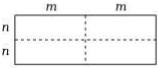
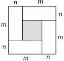
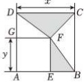

（8分）如图1是一个长为 $2m$、宽为 $2n$ 的长方形（$m>n$），沿图中虚线用剪刀均匀分成四块小长方形，然后按图2形状拼成一个正方形。

（1）请分别用两种不同的方法表示图2中阴影部分的面积：方法一：___ ；方法二：___ ；

（2）观察图2，直接写出代数式 $(m+n)^2$，$(m-n)^2$，$mn$ 之间的关系：___ ；

（3）利用（2）的结论，尝试解决以下问题：

$①$ 已知 $m+n=7$，$mn=6$，则 $(m-n)^2$ 的值为 ___ ；

$②$ 已知：$(4-x)(5-x)=6$，求 $(9-2x)^{2}$ 的值；

（4）两个正方形 $ABCD$，$AEFG$ 如图3摆放，边长分别为 $x$，$y$，若 $x^{2}+y^{2}=34$，$BE=2$，求图中阴影部分面积和。

（图1）

（图2）

（图3）

> [!question]- 点击查看答案与解析
> 【答案】(1) 方法一：$(m+n)^{2}-4mn$；方法二：$(m-n)^{2}$；(2) $(m+n)^{2}=(m-n)^{2}+4mn$；(3) ① $25$；② $25$；(4) $8$
> 
> 【考点】完全平方公式的几何意义与应用 → [[【初中数学知识点体系-人教版】#16-3 乘法公式]]
> 
> 【解析】
> (1) 方法一：大正方形面积减去4个小长方形面积 $=(m+n)^{2}-4mn$；
> 
> 方法二：中间小正方形面积 $=(m-n)^{2}$。
> 
> (2) $(m+n)^{2}=(m-n)^{2}+4mn$，即 $(m-n)^{2}=(m+n)^{2}-4mn$。
> 
> (3) ① $(m-n)^{2}=(m+n)^{2}-4mn=49-24=25$；
> 
> ② 设 $4-x=a$，$5-x=b$，则 $a+b=(4-x)+(5-x)=9-2x$，$ab=(4-x)(5-x)=6$，$b-a=(5-x)-(4-x)=1$。
> 
> $(9-2x)^{2}=(a+b)^{2}=(b-a)^{2}+4ab=1+4\times6=25$。
> 
> (4) 如图3，$E$ 在 $AB$ 上、$G$ 在 $AD$ 上，$AE=AG=EF=y$，$AB=x$，故 $BE=x-y=2$。
> 
> 阴影为 $\triangle DCF$ 与 $\triangle FEB$：$\triangle DCF$ 以 $DC=x$ 为底，$F$ 到 $DC$ 的距离为 $x-y$，面积 $=\frac12 x(x-y)$；$\triangle FEB$ 是直角边为 $FE=y$、$EB=x-y$ 的直角三角形，面积 $=\frac12 y(x-y)$。
> 
> 阴影和 $=\frac12(x-y)(x+y)=\frac12(x^{2}-y^{2})$。
> 
> 由 $x^{2}+y^{2}=34$、$x-y=2$ 得 $xy=\frac{(x^{2}+y^{2})-(x-y)^{2}}{2}=\frac{34-4}{2}=15$，$(x+y)^{2}=34+2\times15=64$，$x+y=8$。
> 
> 故阴影和 $=\frac12(x^{2}-y^{2})=\frac12(x-y)(x+y)=\frac12\times2\times8=8$。
> 
> 验证（$x=5$、$y=3$ 满足 $x^{2}+y^{2}=34$、$BE=2$：$\triangle DCF=\frac12\times5\times2=5$、$\triangle FEB=\frac12\times3\times2=3$，和为 8，与公式 $\frac12(x^{2}-y^{2})=8$ 一致；(1)(2)(3) 恒等式与求解亦逐项验证）：**修正说明**：原解析算出 $xy=15$ 后误把 $xy$ 当作阴影面积和，答案误写 15；按图3 阴影实为 $\triangle DCF$ 与 $\triangle FEB$，面积和 $=\frac12(x^{2}-y^{2})=8$，答案改为 8。
> 
> 【易错点】完全平方公式的灵活变形；(4) 中阴影面积和是 $\frac12(x^2-y^2)$ 而不是 $xy$，须按图3 逐块计算三角形面积。
