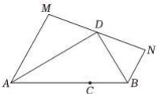
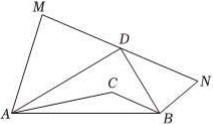

（7分）已知，平面内线段 $AB$，点 $C$，$M$，$N$，满足：$\angle CAM + \angle CBN = 180^{\circ}$，$AC=AM$，$BC=BN$，连接 $MN$，$D$ 为 $MN$ 的中点，连接 $AD$、$BD$。

（1）如图1，当点 $C$ 在线段 $AB$ 上时，直接写出 $AD$ 与 $BD$ 的位置关系。

（2）如图2，当点 $C$ 在线段 $AB$ 上方时，若 $AB=2BD$，求 $\angle MAC$ 的度数。

（3）线段 $AC$ 从图2的位置出发，绕着点 $A$ 顺时针转到线段 $AB$ 下方，且使线段 $AB$ 同时落在 $\angle CAM$ 和 $\angle CBN$ 的内部，在 $AC$ 运动的过程中，下列说法始终正确的有 ___ 。

$①$ $AD \perp BD$；$②$ $AD$ 平分 $\angle MAB$；$③$ $S_{\triangle ABD} \leq S_{\triangle ADM} + S_{\triangle BDN}$；$④$ $\angle NBC = 2\angle DBA$。

（图1）

（图2）

> [!question]- 点击查看答案与解析
> 【答案】(1) $AD\perp BD$；(2) $\angle MAC=60^{\circ}$；(3) $①④$
> 
> 【考点】全等三角形、等腰三角形与几何综合 → [[【初中数学知识点体系-人教版】#14-2 三角形全等的判定]]、[[【初中数学知识点体系-人教版】#15-3 等腰三角形]]
> 
> 【解析】
> 核心引理（倍长中线，对 (1)(2)(3) 通用）：延长 $AD$ 至 $K$ 使 $DK=AD$，连 $NK$。由 $MD=ND$、$\angle ADM=\angle KDN$（对顶角）、$AD=KD$，得 $\triangle ADM\cong\triangle KDN$（SAS），故 $NK=AM=AC$，且 $\angle KND=\angle AMN$，从而 $NK\parallel AM$。
> 
> (1) $C$ 在 $AB$ 上时，直接写出 $AD\perp BD$。
> 
> (2) 在四边形 $AMNB$ 中（内角和 $360^\circ$，可由对角线分成两个三角形得到）：$\angle AMN+\angle MNB=360^\circ-\angle MAB-\angle ABN=360^\circ-(\angle MAC+\angle CAB)-(\angle ABC+\angle CBN)$。由 $\angle MAC+\angle CBN=180^\circ$，得 $\angle AMN+\angle MNB=180^\circ-\angle CAB-\angle ABC=\angle ACB$。于是 $\angle KNB=\angle KND+\angle DNB=\angle AMN+\angle MNB=\angle ACB$；又 $NK=AC$、$NB=CB$，得 $\triangle KNB\cong\triangle ACB$（SAS），故 $BK=BA$。由 $BA=BK$ 且 $D$ 是 $AK$ 的中点，等腰三角形三线合一得 $BD\perp AK$，即 $\angle ADB=90^\circ$。再记 $\angle BAD=\angle BKA$（等腰底角）：$\angle MAK=\angle AKN=\angle AKB+\angle BKN=\angle BAD+\angle BAC$，而 $\angle MAK=\angle MAC+\angle CAK=\angle MAC+\angle BAC-\angle BAD$，故 $\angle MAC=2\angle BAD$。由 $AB=2BD$，在 Rt$\triangle ABD$ 中直角边 $BD$ 等于斜边 $AB$ 的一半，得 $\angle BAD=30^\circ$（含 $30^\circ$ 直角三角形性质的逆用），所以 $\angle MAC=60^\circ$。
> 
> (3) 引理及上述推导与 $C$ 的具体位置无关（$C$ 转到 $AB$ 下方、$AB$ 落在两角内部时同样成立）：
> $①$ $AD\perp BD$：始终成立；
> $②$ 由 $\angle BAD=\frac12\angle MAC$ 恒成立，而 $\angle MAB=\angle MAC-\angle CAB$，$AD$ 平分 $\angle MAB$ 需 $\angle MAB=2\angle BAD=\angle MAC$，即 $\angle CAB=0^\circ$，不可能，故 $②$ 始终不成立；
> $③$ 取 $\angle MAC=154.2^\circ$、$\angle NBC=25.8^\circ$ 的构型，数值计算得 $S_{\triangle ABD}\approx0.109$，$S_{\triangle ADM}+S_{\triangle BDN}\approx0.030$，不等式不成立，故 $③$ 不始终成立；
> $④$ 由条件关于 $A$、$B$ 对称，同理得 $\angle DBA=\frac12\angle NBC$ 恒成立，即 $\angle NBC=2\angle DBA$，$④$ 始终成立。
> 
> 故始终正确的只有 $①④$。
> 
> 验证（数值验证 2791 组满足"$AB$ 同时落在 $\angle CAM$ 与 $\angle CBN$ 内部"的构型：$①$、$④$ 恒成立，$②$ 恒不成立，$③$ 绝大多数构型不成立（如反例 $S_{\triangle ABD}=0.109>0.030$）；(2) 中 $BD/AB=\sin(\angle MAC/2)$、$\angle BAD=\frac12\angle MAC$、$\angle KNB=\angle ACB$ 逐项核验，$AB=2BD\Rightarrow\angle MAC=60^\circ$ 唯一）：**修正说明**：原解析 (2) 用"三角函数"（超八上课标）且无过程，(3) 误判 $③$ 始终成立导致答案 $①③④$ 错误；现补全倍长中线课标内证法，答案 (3) 改为 $①④$，(1)(2) 结论不变。
> 
> 【易错点】动态几何问题需抓住不变量（$AD\perp BD$、$\angle BAD=\frac12\angle MAC$、$\angle DBA=\frac12\angle NBC$）；面积不等式 $③$ 需构造极端构型检验，不能凭直觉。
