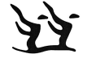

1. （2025八上·海淀期末）下列体育运动的图案中，是轴对称图形的是（ ）

A. 

B. 

C. 

D. 

> [!question]- 点击查看答案与解析
> 【答案】C
> 
> 【考点】轴对称图形的识别 → [[【初中数学知识点体系-人教版】#15-1 图形的轴对称]]
> 
> 【解析】
> 判断依据：如果一个平面图形沿一条直线折叠，直线两旁的部分能够互相重合，这个图形就是轴对称图形。
> - 选项 A：运动人形一腿前跨、一臂后摆，左右肢体朝向不一致，找不到对称轴；
> - 选项 B：人物双臂与腿部分布左右不对称；
> - 选项 C：举重人形两臂上举、双腿分立，关于经过重心的竖直直线左右对称，折叠后两旁重合；
> - 选项 D：奔跑人形身体前倾、四肢错开，不关于任何直线对称。
> 综上，选 C。
> 
> 【易错点】只看外轮廓的大致居中，忽略内部肢体的朝向与分布；把“看起来对称”等同于轴对称。