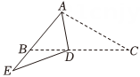

7. （2025八上·海淀期末）如图，在 $\triangle ABC$ 中，$\angle ABC=50^{\circ}$，$\angle C=30^{\circ}$，$AD$ 是 $\triangle ABC$ 的角平分线，将 $\triangle ACD$ 沿 $AD$ 所在直线折叠，得到 $\triangle AED$，则 $\angle BDE$ 的大小为（ ）

A. $10^{\circ}$

B. $20^{\circ}$

C. $30^{\circ}$

D. $40^{\circ}$

> [!question]- 点击查看答案与解析
> 【答案】B
> 
> 【考点】三角形内角和 → [[【初中数学知识点体系-人教版】#13-3 三角形的内角与外角]]、折叠的全等性质 → [[【初中数学知识点体系-人教版】#14-1 全等三角形及其性质]]、轴对称 → [[【初中数学知识点体系-人教版】#15-1 图形的轴对称]]
> 
> 【解析】
> 在 $\triangle ABC$ 中，$\angle BAC=180^{\circ}-50^{\circ}-30^{\circ}=100^{\circ}$。$AD$ 平分 $\angle BAC$，故 $\angle BAD=\angle CAD=50^{\circ}$。
> 在 $\triangle ADC$ 中，$\angle ADC=180^{\circ}-\angle CAD-\angle C=180^{\circ}-50^{\circ}-30^{\circ}=100^{\circ}$。
> 由折叠知 $\triangle AED\cong\triangle ACD$，故 $\angle ADE=\angle ADC=100^{\circ}$。又 $\angle ADB=180^{\circ}-\angle ADC=80^{\circ}$，所以 $\angle BDE=\angle ADE-\angle ADB=100^{\circ}-80^{\circ}=20^{\circ}$。
> 
> 【易错点】折叠前后对应角相等；$\angle ADC$ 与 $\angle ADB$ 互为邻补角，不要把折叠角直接当作所求角。