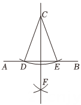

8. （2025八上·海淀期末）过直线 $AB$ 外一点 $C$，用尺规作 $AB$ 的垂线，如图所示，其中点 $F$ 是分别以点 $D$ 和点 $E$ 为圆心、$DE$ 为半径的两弧的交点。若 $\angle CDF=130^{\circ}$，则 $\angle ECF$ 的大小为（ ）

A. $35^{\circ}$

B. $30^{\circ}$

C. $25^{\circ}$

D. $20^{\circ}$

> [!question]- 点击查看答案与解析
> 【答案】D
> 
> 【考点】等腰、等边三角形角度计算 → [[【初中数学知识点体系-人教版】#13-3 三角形的内角与外角]]、尺规作垂线（垂直平分线） → [[【初中数学知识点体系-人教版】#15-2 画轴对称的图形]]
> 
> 【解析】
> 由作法，$DF=EF=DE$，故 $\triangle DEF$ 为等边三角形，$\angle EDF=60^{\circ}$。又 $CD=CE$（同以 $C$ 为圆心所作弧的半径），$\triangle CDE$ 为等腰三角形。
> $\angle CDE=\angle CDF-\angle EDF=130^{\circ}-60^{\circ}=70^{\circ}$，故 $\angle DCE=180^{\circ}-2\times70^{\circ}=40^{\circ}$。
> $C$、$F$ 都在 $DE$ 的垂直平分线上，$CF$ 平分 $\angle DCE$，所以 $\angle ECF=\frac{1}{2}\angle DCE=20^{\circ}$。
> 
> 【易错点】等边三角形内角为 $60^{\circ}$，等腰三角形两底角相等；中垂线上的点到线段两端距离相等，且连线平分等腰三角形顶角。