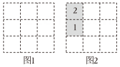

10. （2025八上·海淀期末）图1 是一个 $3\times3$ 的正方形网格纸，甲、乙两人在网格中进行游戏，规则如下：

$①$ 两人轮流将网格中的白色方格涂黑，每次涂一个格子；

$②$ 每次涂色需使涂色后网格中所有黑色方格构成轴对称图形，否则不可涂色；

$③$ 若一方无法涂色，则游戏结束，对方获胜。

如图2，甲先涂了 1 号方格，乙随后涂了 2 号方格，则这局游戏的获胜者能涂黑的方格数最多为（ ）

A. 2

B. 3

C. 4

D. 5

> [!question]- 点击查看答案与解析
> 【答案】B
> 
> 【考点】轴对称图形的判定 → [[【初中数学知识点体系-人教版】#15-1 图形的轴对称]]、画轴对称的图形 → [[【初中数学知识点体系-人教版】#15-2 画轴对称的图形]]
> 
> 【解析】
> 已涂黑的 1 号（正中）、2 号（上中）关于竖直中线对称。下一步可涂黑下中格，三格组成竖直一列，仍关于竖直中线轴对称；此后其余方格均在中线一侧，单独涂黑都会破坏轴对称，对方无法再涂。游戏结束时共涂黑 3 格，获胜者能涂黑的方格数最多为 3。
> 
> 【易错点】轴对称的对称轴由当前黑色图形确定；注意题目问的是游戏结束时黑色方格总数，而不是某一方各自涂的格数。