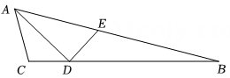
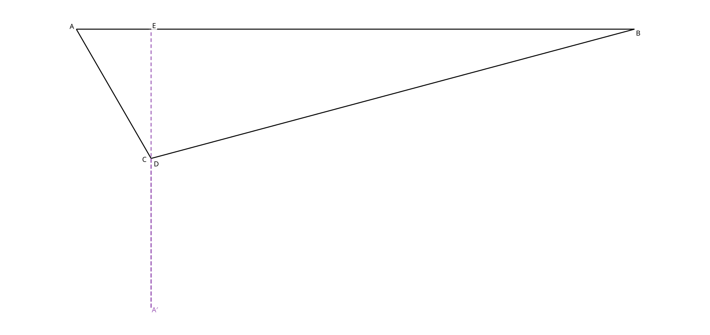

15. （2025八上·海淀期末）如图，$\triangle ABC$ 中，$\angle CAB=60^{\circ}$，$\angle B=15^{\circ}$，$AC=4$，点 $D$，$E$ 分别是线段 $CB$，$AB$ 上的动点，当 $AD+DE$ 最小时，$AE$ 的长是 ___ .

> [!question]- 点击查看答案与解析
> 【答案】$2$
> 
> 【考点】轴对称变换求最短路径 → [[【初中数学知识点体系-人教版】#15-2 画轴对称的图形]]、三角形内角和 → [[【初中数学知识点体系-人教版】#13-3 三角形的内角与外角]]
> 
> 【解析】
> 作点 $A$ 关于直线 $CB$ 的对称点 $A'$，由对称性 $AD=A'D$，故 $AD+DE=A'D+DE\geq A'E$；当 $A'$、$D$、$E$ 共线，且 $A'E\perp AB$ 时取最小值。
> 由 $\angle CAB=60^{\circ}$，$\angle B=15^{\circ}$，得 $\angle ACB=105^{\circ}$。反射后 $CA'=CA=4$，$\angle ACA'=360^{\circ}-2\times105^{\circ}=150^{\circ}$，故 $\angle CAA'=15^{\circ}$，$AA'=2\cdot AC\sin75^{\circ}=8\sin75^{\circ}$。
> $\angle A'AE=75^{\circ}$，$AE=AA'\cos75^{\circ}=8\sin75^{\circ}\cos75^{\circ}=4\sin150^{\circ}=2$。
> 
> 
> 【易错点】最短路径问题先作对称点化折为直；反射前后对应线段、对应角相等；最后垂足到端点的线段长度要在直角三角形中计算。