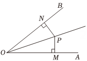

20. （2025八上·海淀期末）如图，$P$ 为 $\angle AOB$ 内部的一点，$PM\perp OA$，$PN\perp OB$，垂足分别为 $M$，$N$。写出命题“若 $\angle AOP=\angle BOP$，则 $PM=PN$”的逆命题，并证明该逆命题。

> [!question]- 点击查看答案与解析
> 【答案】逆命题：若 $PM=PN$，则 $\angle AOP=\angle BOP$
> 
> 【考点】直角三角形全等判定（HL） → [[【初中数学知识点体系-人教版】#14-2 三角形全等的判定]]、角的平分线 → [[【初中数学知识点体系-人教版】#14-3 角的平分线]]、定义、命题、定理 → [[【初中数学知识点体系-人教版】#7-3 定义、命题、定理]]
> 
> 【解析】
> 证明：$\because PM\perp OA$，$PN\perp OB$，$\therefore\angle PMO=\angle PNO=90^{\circ}$。
> 在 Rt$\triangle POM$ 和 Rt$\triangle PON$ 中，$PO=PO$，$PM=PN$，$\therefore$ Rt$\triangle POM\cong$ Rt$\triangle PON$（HL）。
> $\therefore\angle MOP=\angle NOP$，即 $\angle AOP=\angle BOP$。
> 
> 【易错点】逆命题是把原命题的条件和结论互换；证明两个直角三角形全等用 HL 时，斜边公共、直角边对应相等，不要误用一般三角形的判定条件。