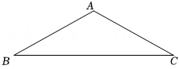
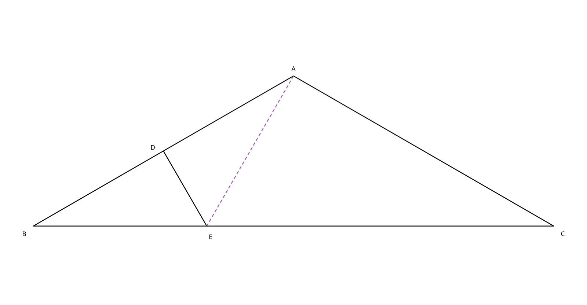

21. （2025八上·海淀期末）如图，在 $\triangle ABC$ 中，$AB=AC$，$\angle A=120^{\circ}$。

（1）请用无刻度的直尺和圆规作线段 $AB$ 的垂直平分线 $DE$，分别交 $AB$，$BC$ 于点 $D$，$E$；（保留作图痕迹，不写作法，标明字母）

（2）用等式表示线段 $CE$ 与 $BE$ 的数量关系，并证明。

> [!question]- 点击查看答案与解析
> 【答案】$CE=2BE$
> 
> 【考点】线段垂直平分线的性质 → [[【初中数学知识点体系-人教版】#15-2 画轴对称的图形]]、等腰三角形 → [[【初中数学知识点体系-人教版】#15-3 等腰三角形]]、三角形内角和 → [[【初中数学知识点体系-人教版】#13-3 三角形的内角与外角]]
> 
> 【解析】
> （1）分别以 $A$、$B$ 为圆心，大于 $\frac{1}{2}AB$ 的长为半径作弧，两弧交于两点，过两点作直线，即 $AB$ 的垂直平分线 $DE$，交 $AB$ 于 $D$，交 $BC$ 于 $E$。
> （2）证明：连接 $AE$。$\because AB=AC$，$\therefore\angle B=\angle C$。又 $\angle BAC=120^{\circ}$，$\therefore\angle B=\angle C=30^{\circ}$。
> $\because E$ 在线段 $AB$ 的垂直平分线上，$\therefore EA=EB$，$\therefore\angle EAB=\angle B=30^{\circ}$，$\therefore\angle EAC=\angle BAC-\angle EAB=90^{\circ}$。
> 在 Rt$\triangle AEC$ 中，$\angle C=30^{\circ}$，$\therefore CE=2AE=2BE$。
> 
> 
> 【易错点】垂直平分线上的点到线段两端距离相等；含 $30^{\circ}$ 角的直角三角形中，$30^{\circ}$ 角所对直角边等于斜边的一半，注意对应边不要写反。