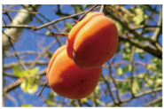

22. （2025八上·海淀期末）柿子在中国文化中具有丰富的寓意，常被视为吉祥的象征。近年来，某村成立合作社，新增柿子的种植面积 300 亩。已知该村成立合作社前柿子年产量为 90 万千克，在亩产量不变的情况下，成立合作社后年产量达到 135 万千克。求该村成立合作社前柿子的种植面积。（列分式方程解答）

> [!question]- 点击查看答案与解析
> 【答案】$600$ 亩
> 
> 【考点】列分式方程解决实际问题 → [[【初中数学知识点体系-人教版】#18-5 分式方程]]
> 
> 【解析】
> 设该村成立合作社前柿子种植面积为 $x$ 亩，则成立后种植面积为 $(x+300)$ 亩。
> 由亩产量不变，得 $\frac{90}{x}=\frac{135}{x+300}$。
> 方程两边乘 $x(x+300)$，得 $90(x+300)=135x$，解得 $x=600$。
> 检验：当 $x=600$ 时，$x(x+300)\neq0$，故 $x=600$ 是原分式方程的解，且符合题意。
> 答：该村成立合作社前柿子种植面积为 $600$ 亩。
> 
> 【易错点】分式方程必须检验根是否使分母为零；等量关系是“亩产量不变”，不要把前后年产量直接相减列方程。