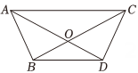

23. （2025八上·海淀期末）如图，$AD$ 与 $BC$ 相交于点 $O$，. $AB=CD$，$\angle OAB=\angle OCD$，求证：$AC\parallel BD$。

> [!question]- 点击查看答案与解析
> 【答案】证明见解析，$AC\parallel BD$
> 
> 【考点】全等三角形判定（AAS） → [[【初中数学知识点体系-人教版】#14-2 三角形全等的判定]]、平行线的判定 → [[【初中数学知识点体系-人教版】#7-2 平行线]]
> 
> 【解析】
> 证明：在 $\triangle AOB$ 和 $\triangle COD$ 中，
> $\angle AOB=\angle COD$（对顶角相等），$\angle OAB=\angle OCD$，$AB=CD$，
> $\therefore\triangle AOB\cong\triangle COD$（AAS）。
> $\therefore OA=OC$，$OB=OD$。
> $\therefore\angle OAC=\angle OCA$，$\angle OBD=\angle ODB$。
> $\because\angle OCA=\frac{180^{\circ}-\angle AOC}{2}$，$\angle OBD=\frac{180^{\circ}-\angle BOD}{2}$，而 $\angle AOC=\angle BOD$（对顶角相等），
> $\therefore\angle OCA=\angle OBD$，$\therefore AC\parallel BD$（内错角相等，两直线平行）。
> 
> 【易错点】全等三角形对应边、对应角要写对；由等腰三角形底角相等推出内错角相等，再判定平行，不要跳过等腰三角形这一步。