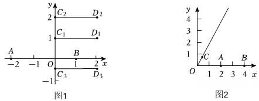

25. （2025八上·海淀期末）在平面直角坐标系 $xOy$ 中，对于线段 $AB$ 和线段 $CD$ 给出如下定义：若存在点 $P$（不在直线 $AB$ 和直线 $CD$ 上），使得 $\angle PAB$，$\angle PBA$，$\angle PCD$，$\angle PDC$ 的大小均不超过 $\theta$，则称 $AB$ 和 $CD$ 具有性质 $P_{\theta}$。

（1）如图1，点 $A(-2, 0)$，$B(1, 0)$，$C_{1}(0, 1)$，$D_{1}(2, 1)$，$C_{2}(0, 2)$，$D_{2}(2, 2)$，$C_{3}(0,-\frac{1}{2})$，$D_{3}(2,-\frac{1}{2})$。在线段 $C_{1}D_{1}$，$C_{2}D_{2}$，$C_{3}D_{3}$ 中，和 $AB$ 具有性质. $P_{45^{\circ}}$ 的是 ___ ；

（2）如图2，点 $A(2, 0)$，$B(4, 0)$，点 $C$，$D$ 在第一象限内以原点为端点的同一条射线上，且 $\angle AOC=60^{\circ}$，点 $C$，$D$ 的横坐标分别记为 $u$，$v$，满足 $0<u<v$。

$①$ 若 $AB$ 和 $CD$ 具有性质 $P_{60^{\circ}}$，则当 $u=\frac{1}{2}$ 时，$v$ 的取值范围是 ___ ；

$②$ 若 $AB$ 和 $CD$ 具有性质 $P_{90^{\circ}}$，且不具有性质 $P_{60^{\circ}}$，直接写出 $u$，$v$ 还应满足的关系。

> [!question]- 点击查看答案与解析
> 【答案】（1）$C_{1}D_{1}$、$C_{3}D_{3}$；（2）① $v\geq\frac{3}{2}$；② $u>1$ 或 $v-u<1$
> 
> 【考点】用坐标描述平面内点的位置 → [[【初中数学知识点体系-人教版】#9-1 用坐标描述平面内点的位置]]、坐标方法的简单应用 → [[【初中数学知识点体系-人教版】#9-2 坐标方法的简单应用]]
> 
> 【解析】
> （1）$\theta=45^{\circ}$ 时，分别在线段两端点作与线段成 $45^{\circ}$ 的射线，两条线段两端的楔形区域存在公共点 $P$ 即具性质。$C_{1}D_{1}$ 与 $AB$ 上下相对，楔形在两线之间相交；$C_{2}D_{2}$ 距离 $AB$ 过远，楔形不相交；$C_{3}D_{3}$ 在 $AB$ 下方，楔形在下方相交。故具有性质 $P_{45^{\circ}}$ 的是 $C_{1}D_{1}$、$C_{3}D_{3}$。
> （2）① $u=\frac{1}{2}$ 时，由过 $A$、$B$ 的 $60^{\circ}$ 射线与过 $C$、$D$ 的 $60^{\circ}$ 射线围成的区域存在公共点，得 $v\geq\frac{3}{2}$。
> ② 具有性质 $P_{90^{\circ}}$ 但不具有性质 $P_{60^{\circ}}$ 时，$u>1$ 或 $v-u<1$。
> 
> 【易错点】定义中的四个角都是端点处射线与线段本身的夹角；$P$ 不能落在两条线段所在直线上；取值范围的边界能否取到要结合“不超过 $\theta$”判断。