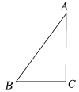
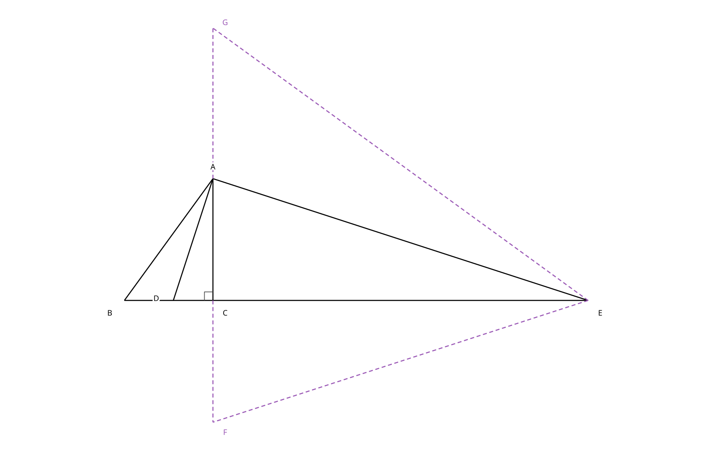

26. （2025八上·海淀期末）如图，在 $\mathrm{Rt}\triangle ABC$ 中，$\angle ACB=90^{\circ}$。作 $\angle BAC$ 的角平分线 $AD$ 交 $BC$ 于点 $D$，过点 $A$ 作 $AE\perp AD$ 交 $BC$ 的延长线于点 $E$。

（1）$①$ 依题意补全图形；

$②$ 求证：$\angle BAE+\angle CAE=180^{\circ}$；

（2）若 $AB+2AC=AE$，求 $\angle ABC$ 的大小。

> [!question]- 点击查看答案与解析
> 【答案】（1）② 证明见解析；（2）$\angle ABC=54^{\circ}$
> 
> 【考点】全等三角形判定（SAS） → [[【初中数学知识点体系-人教版】#14-2 三角形全等的判定]]、角的平分线 → [[【初中数学知识点体系-人教版】#14-3 角的平分线]]、三角形内角与外角 → [[【初中数学知识点体系-人教版】#13-3 三角形的内角与外角]]
> 
> 【解析】
> （1）② 证明：$\because AD$ 平分 $\angle BAC$，$\therefore\angle BAD=\angle DAC$。
> $\because AE\perp AD$，$\therefore\angle DAE=90^{\circ}$。
> $\angle BAE=\angle BAD+\angle DAE=\angle BAD+90^{\circ}$，
> $\angle CAE=\angle DAE-\angle DAC=90^{\circ}-\angle BAD$，
> $\therefore\angle BAE+\angle CAE=180^{\circ}$。
> （2）延长 $CA$ 到 $F$，使 $CF=AC$；延长 $CA$ 到 $G$，使 $AG=AB$，连接 $EF$、$EG$。
> $\because\angle ACB=90^{\circ}$，$\therefore CE$ 垂直平分 $AF$，$\therefore EF=AE$，$\angle CAE=\angle F$。
> 由 $\angle BAE+\angle CAE=180^{\circ}$，$\angle GAE+\angle CAE=180^{\circ}$，得 $\angle BAE=\angle GAE$。
> 在 $\triangle ABE$ 和 $\triangle AGE$ 中，$AB=AG$，$\angle BAE=\angle GAE$，$AE=AE$，$\therefore\triangle ABE\cong\triangle AGE$（SAS），$\therefore\angle G=\angle ABE$。
> $GF=AG+AC+CF=AB+2AC=AE=EF$，$\therefore EF=GF$，即 $\triangle EFG$ 为等腰三角形，$\angle G=\angle GEF$。
> 设 $\angle ABC=\angle ABE=\beta$，由 $\angle G=\angle ABE$ 得 $\angle G=\angle GEF=\beta$，故 $\angle F=180^{\circ}-2\beta$。又 $\angle CAE=\angle F$，$\angle BAE=180^{\circ}-\angle CAE=2\beta$，$\angle BAC=\angle BAE-\angle CAE=4\beta-180^{\circ}$。
> 在 Rt$\triangle ABC$ 中，$\angle ABC+\angle BAC=90^{\circ}$，$\therefore\beta+4\beta-180^{\circ}=90^{\circ}$，$5\beta=270^{\circ}$，$\beta=54^{\circ}$，即 $\angle ABC=54^{\circ}$。
> 
> 
> 【易错点】辅助线通过延长线段截长补短，构造全等三角形；垂直平分线上的点到两端距离相等；角度推导中注意 $\angle BAE$ 与 $\angle CAE$ 分别在 $AD$ 两侧，不要把角的和差关系写反。