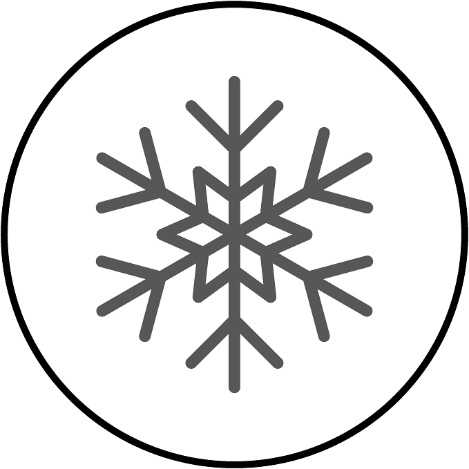

1. （2025八上·海淀期中）下列图形中，轴对称图形是（ ）

A. 

B. 

C. 

D. 

> [!question]- 点击查看答案与解析
> 【答案】A
> 
> 【考点】轴对称图形的识别 → [[【初中数学知识点体系-人教版】#15-1 图形的轴对称]]
> 
> 【解析】
> 逐一判断每个图案能否沿某条直线折叠后两部分完全重合：
> - 选项 A：雪花图案关于过中心的竖直（以及若干条）直线对称，折叠后两旁完全重合，是轴对称图形；
> - 选项 B：圆内的闪电与三角分居中心两侧，形状与朝向都不同，找不到对称轴；
> - 选项 C：电动车图案上下两片叶子朝向相反，一侧向左、一侧向右，不对称；
> - 选项 D：禁烟标志中的斜杠只占一个对角方向，整体不关于任何直线对称。
> 综上，选 A。
> 
> 【易错点】只看图案是否“摆在中间”而不检查内部细节（斜杠、箭头、叶片朝向），容易把 D 误判为轴对称图形。
