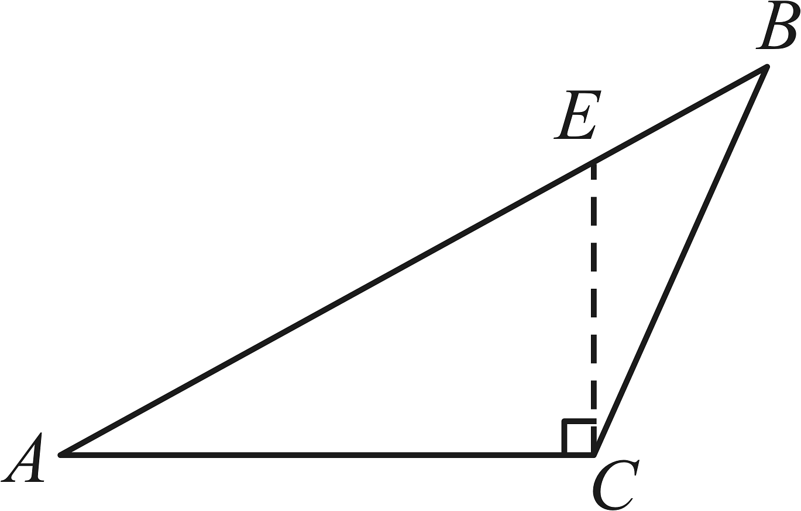
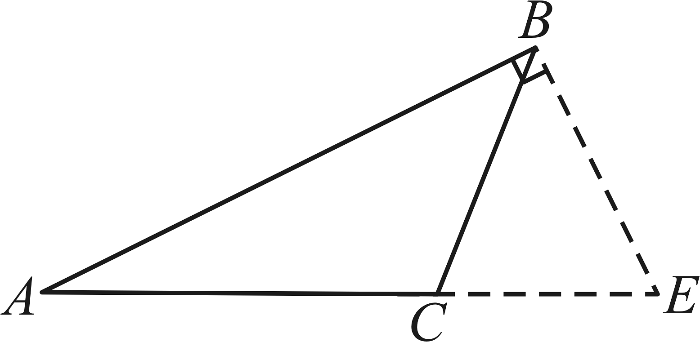
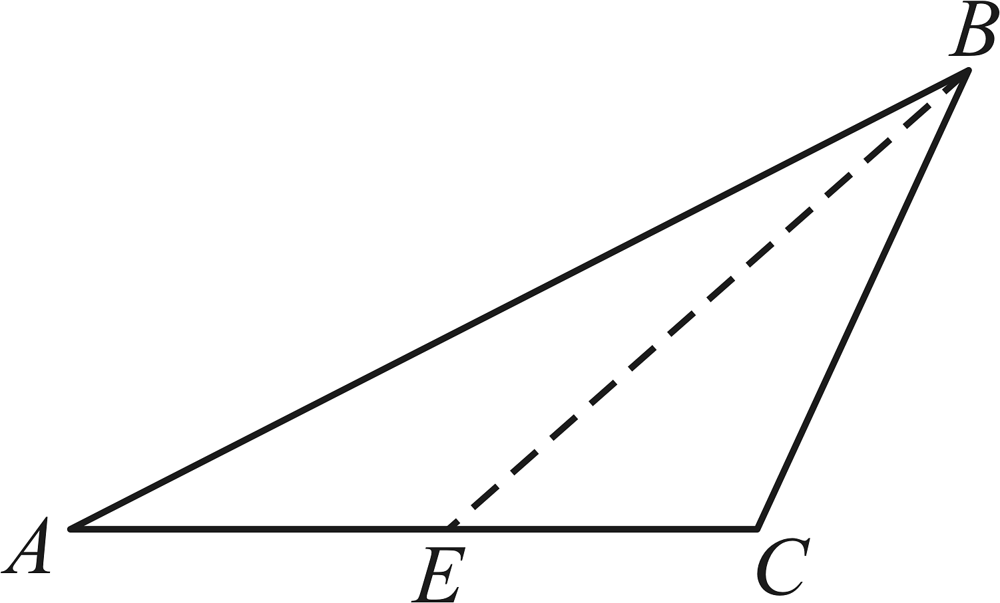
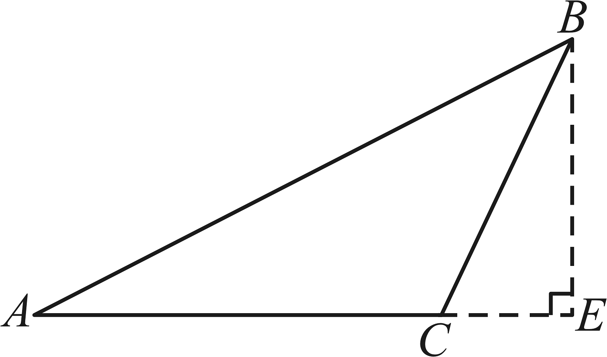

3. （2025八上·北京期中）画 $\triangle ABC$ 中边 $AC$ 上的高，正确的是（ ）

A. 

B. 

C. 

D. 

> [!question]- 点击查看答案与解析
> 【答案】D
> 
> 【考点】三角形的高线作图 → [[【初中数学知识点体系-人教版】#13-2 与三角形有关的线段]]
> 
> 【解析】
> 边 $AC$ 上的高是指过顶点 $B$ 且垂直于 $AC$（所在直线）的线段，垂足可以落在 $AC$ 的延长线上。
> - A：从 $AB$ 边上一点向 $C$ 连线，与 $AC$ 不垂直，且不过顶点 $B$；
> - B：所作虚线与 $BC$ 垂直，是 $BC$ 边上的高的方向，不是 $AC$ 边上的高；
> - C：过 $B$ 到 $AC$ 的连线只是普通线段（近似中线），没有直角标记，不是高；
> - D：过 $B$ 作 $BE\perp AC$，垂足 $E$ 落在 $AC$ 的延长线上，并标出直角符号，符合“钝角三角形中 $AC$ 边上的高”。
> 综上，选 D。
> 
> 【易错点】把“底边”认错，或认为高一定落在三角形内部；钝角三角形中两条高在形外，须把底边延长后再作垂线。
