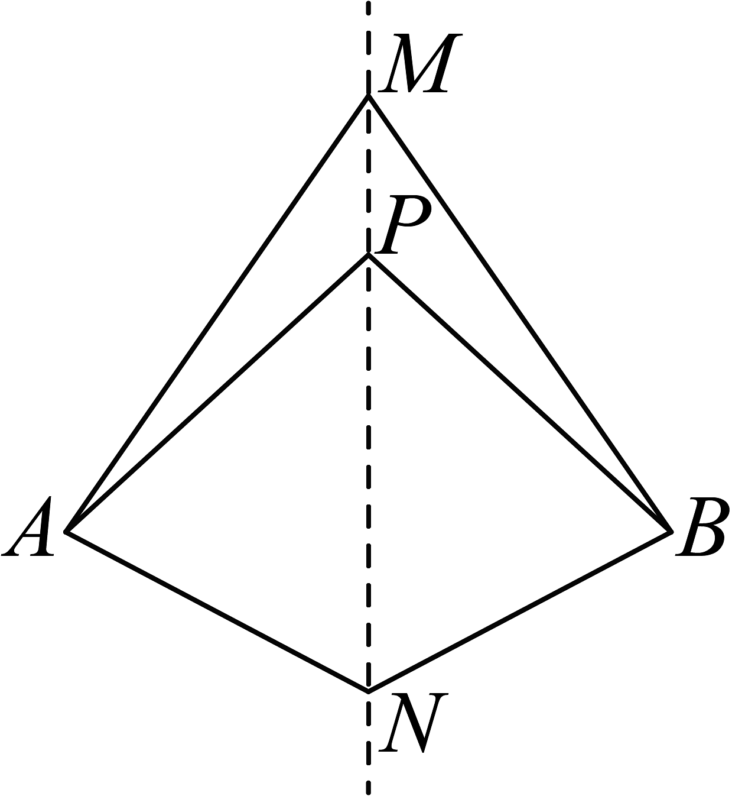

4. （2025八上·海淀期中）如图，直线 $MN$ 是四边形 $AMBN$ 的对称轴，点 $P$ 是直线 $MN$ 上的点，下列判断错误的是（ ）

A. $AN=BN$

B. $\angle AMN=\angle BMN$

C. $\angle PAN=\angle PBN$

D. $AP=AN$

> [!question]- 点击查看答案与解析
> 【答案】D
> 
> 【考点】轴对称的性质 → [[【初中数学知识点体系-人教版】#15-1 图形的轴对称]]、对称轴上的点 → [[【初中数学知识点体系-人教版】#15-2 画轴对称的图形]]
> 
> 【解析】
> 直线 $MN$ 是四边形 $AMBN$ 的对称轴，说明 $A$ 与 $B$ 关于 $MN$ 对称，点 $M$、$N$ 都在对称轴上。
> - A. 由对称点性质，$AN=BN$，正确；
> - B. $AM$ 与 $BM$ 互为对称线段，折叠后 $\angle AMN$ 与 $\angle BMN$ 重合，正确；
> - C. $P$ 在对称轴上，故 $PA=PB$，折叠后 $\angle PAN$ 与 $\angle PBN$ 重合，正确；
> - D. 折叠只能得到 $PA=PB$，$AP$ 与 $AN$ 之间没有任何相等关系，错误。
> 题目要求选错误的，综上，选 D。
> 
> 【易错点】把“对称轴上的点到一对对称点距离相等”错记成“到顶点与轴上点距离相等”，从而认为 $AP=AN$ 成立。
