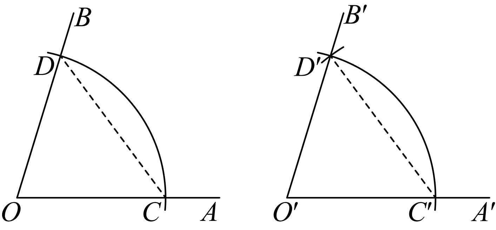

5. （2025八上·海淀期中）下面是“作一个角使其等于 $\angle AOB$”的尺规作图方法。

（1）如图，以点 $O$ 为圆心，任意长为半径画弧，分别交 $OA$，$OB$ 于点 $C$，$D$；

（2）作射线 $O'A'$，以 $O'$ 为圆心，$OC$ 长为半径画弧，交 $O'A'$ 于点 $C'$；以点 $C'$ 为圆心，$CD$ 长为半径画弧，两弧交于点 $D'$；

（3）过点 $D'$ 作射线 $O'B'$，则 $\angle A'O'B'=\angle AOB$。

上述方法通过判定 $\triangle COD\cong \triangle C'O'D'$，得 $\angle A'O'B'=\angle AOB$，其中判定 $\triangle COD\cong \triangle C'O'D'$ 的依据是（ ）

A. $ASA$

B. $SSA$

C. $SSS$

D. $AAS$

> [!question]- 点击查看答案与解析
> 【答案】C
> 
> 【考点】全等三角形的判定（SSS） → [[【初中数学知识点体系-人教版】#14-2 三角形全等的判定]]
> 
> 【解析】
> 由作图过程可得三组对应边相等：
> $OC=O'C'$（都以 $O$ 与 $O'$ 为圆心、同一半径作弧），$OD=O'D'$（同理），$CD=C'D'$（以 $C'$ 为圆心、$CD$ 长为半径作弧，两弧交于 $D'$）。
> 三边对应相等，故 $\triangle COD\cong\triangle C'O'D'$，依据是 $SSS$，于是 $\angle COD=\angle C'O'D'$，即 $\angle AOB=\angle A'O'B'$。
> 综上，选 C。
> 
> 【易错点】图中三个条件全是边，没有夹角也没有两角，误选 $SAS$ 或 $ASA$；也有把 $CD=C'D'$ 错当成 $O'D'$ 的边。
