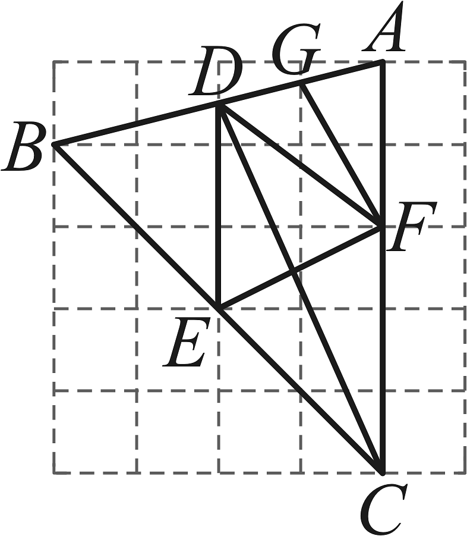

6. （2025八上·海淀期中）如图，$\triangle ABC$ 为边长为 1 个单位长度的正方形网格中的格点三角形，则其重心在（ ）

A. 线段 $FG$ 上

B. 线段 $DC$ 上

C. 线段 $EF$ 上

D. 线段 $DE$ 上

> [!question]- 点击查看答案与解析
> 【答案】B
> 
> 【考点】三角形的中线与重心 → [[【初中数学知识点体系-人教版】#13-2 与三角形有关的线段]]
> 
> 【解析】
> 图中 $D$、$E$、$F$ 分别是 $AB$、$BC$、$AC$ 三边的中点，$CD$、$AE$、$BF$ 是三条中线，$G$ 只是 $AB$ 边上另取的一点。
> 三角形的重心是三条中线的交点，因此重心一定落在每一条中线上。
> - A. 线段 $FG$ 不含中线，重心不在其上；
> - B. 线段 $DC$ 是顶点 $C$ 到 $AB$ 中点 $D$ 的中线，重心在其上，正确；
> - C. 线段 $EF$、D. 线段 $DE$ 都是连接两边中点的中位线，不含重心。
> 综上，选 B。
> 
> 【易错点】把“中位线”与“中线”混为一谈；忘记“重心在每条中线上”（且重心分中线为 $2:1$）。
