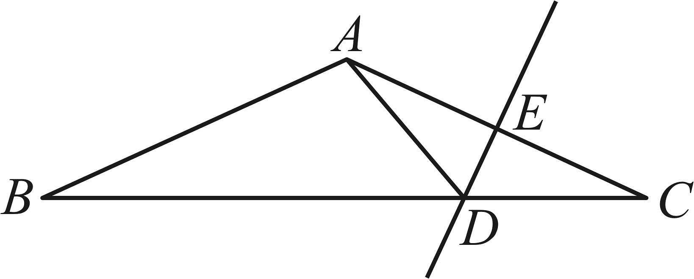

7. （2025八上·海淀期中）如图，在 $\triangle ABC$ 中，$DE$ 是 $AC$ 的垂直平分线，$\triangle ABC$ 的周长为 16，$\triangle ABD$ 的周长为 10，则 $AE$ 的长为（ ）

A. 3

B. 4

C. 5

D. 6

> [!question]- 点击查看答案与解析
> 【答案】A
> 
> 【考点】线段垂直平分线的性质 → [[【初中数学知识点体系-人教版】#15-1 图形的轴对称]]
> 
> 【解析】
> $DE$ 是 $AC$ 的垂直平分线，故 $AE=CE$，$AD=CD$。
> 由 $\triangle ABC$ 的周长得 $AB+BC+AC=16$；
> 由 $\triangle ABD$ 的周长得 $AB+BD+AD=10$，把 $AD$ 换成 $CD$，即 $AB+BD+CD=10$，也就是 $AB+BC=10$。
> 两式相减得 $AC=6$，所以 $AE=\dfrac{1}{2}AC=3$。
> 综上，选 A。
> 
> 【易错点】不会用 $AD=CD$ 把第二个周长化成 $AB+BC$；或把 $\triangle ABD$ 周长误算成 $AB+BD+DE$。
