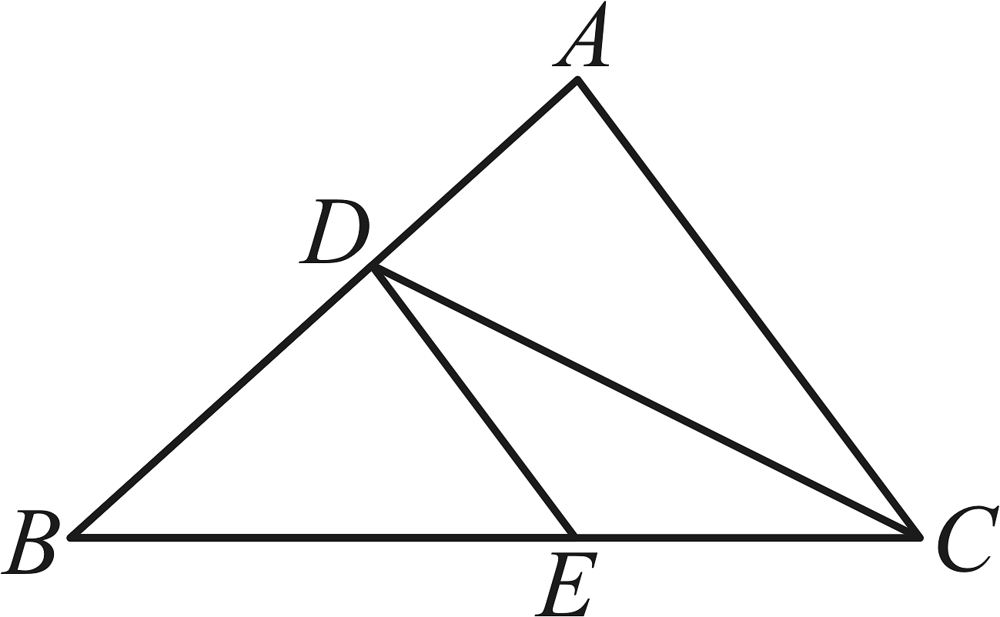

8. （2025八上·海淀期中）如图，$\triangle ABC$ 中，$CD$ 平分 $\angle ACB$，$DE\parallel AC$ 交 $BC$ 于点 $E$，若 $BC=7$，$DE=3$，则 $BE$ 长度为（ ）

A. 4.5

B. 3

C. 4

D. 5

> [!question]- 点击查看答案与解析
> 【答案】C
> 
> 【考点】平行线与等腰三角形（等角对等边） → [[【初中数学知识点体系-人教版】#15-3 等腰三角形]]、角平分线 → [[【初中数学知识点体系-人教版】#14-3 角的平分线]]
> 
> 【解析】
> $CD$ 平分 $\angle ACB$，故 $\angle ACD=\angle DCB$；
> $DE\parallel AC$，内错角相等，故 $\angle CDE=\angle ACD$；
> 于是 $\angle CDE=\angle DCE$，由等角对等边得 $CE=DE=3$。
> 所以 $BE=BC-CE=7-3=4$。
> 综上，选 C。
> 
> 【易错点】看出 $DE\parallel AC$ 却不去代出等腰三角形，停留在角相等；把 $DE$ 当作 $BC$ 的一段直接相减。
