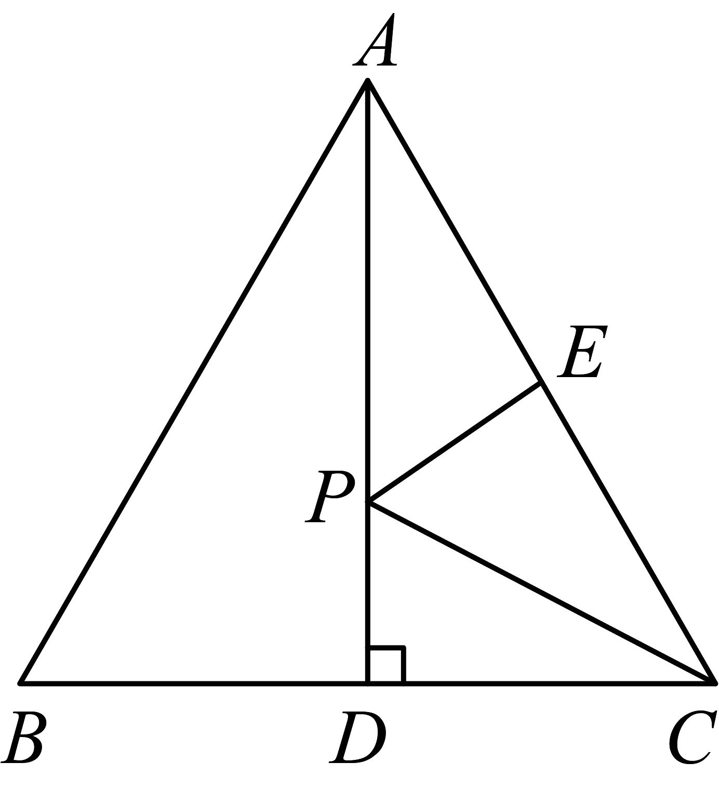
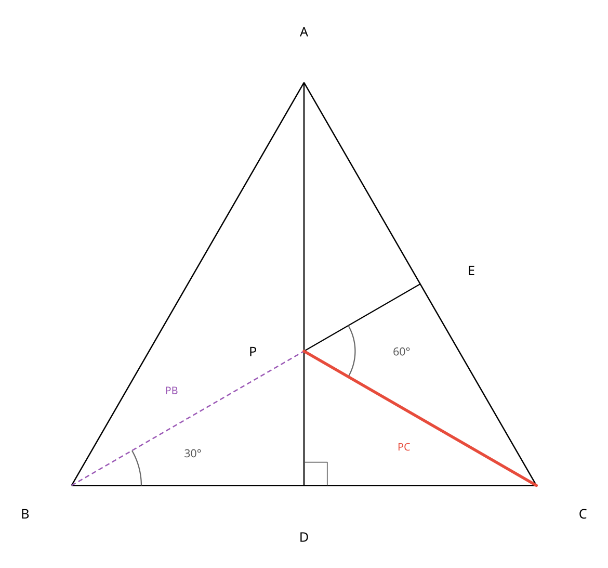

9. （2025八上·温州月考）如图，$\triangle ABC$ 是等边三角形，$AD$ 是 $BC$ 边上的高，点 $E$ 是 $AC$ 边的中点，点 $P$ 是 $AD$ 上的一个动点，当 $PC+PE$ 最小时，$\angle CPE$ 的度数是（ ）。

A. $30^{\circ}$

B. $45^{\circ}$

C. $60^{\circ}$

D. $90^{\circ}$

> [!question]- 点击查看答案与解析
> 【答案】C
> 
> 【考点】等边三角形的对称性 → [[【初中数学知识点体系-人教版】#15-3 等腰三角形]]、轴对称与最短路径 → [[【初中数学知识点体系-人教版】#15-1 图形的轴对称]]
> 
> 【解析】
> 如图，等边 $\triangle ABC$ 中，$AD$ 是 $BC$ 边上的高，也是 $BC$ 的垂直平分线（对称轴），所以 $B$ 与 $C$ 关于 $AD$ 对称，$PB=PC$。
> 于是 $PC+PE=PB+PE$，其最小值在 $B$、$P$、$E$ 三点共线时取到，此时 $P$ 是 $BE$ 与 $AD$ 的交点。
> $BE$ 是 $AC$ 边上的中线，也平分 $\angle ABC$，故 $\angle PBC=30^{\circ}$；又 $PB=PC$，得 $\angle PCB=30^{\circ}$，
> 所以 $\angle BPC=180^{\circ}-30^{\circ}-30^{\circ}=120^{\circ}$。
> 因 $E$ 在 $BP$ 的延长线上，$\angle CPE=180^{\circ}-\angle BPC=60^{\circ}$。
> 综上，选 C。
> 
> 
> 
> 【易错点】只写出“作对称点”而不把 $PC+PE$ 化成一条线段 $BE$；把 $\angle CPE$ 与 $\angle BPC$ 混为一谈（二者互为邻补角）。
